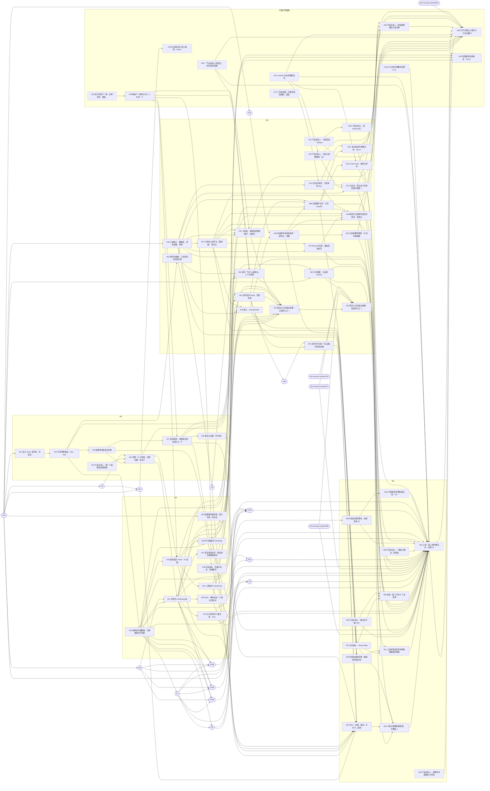

# 关口三 b：PRD 拆成规格和票

> **2026-11-11 按 PRD v2.0 重做。** PRD v2.0（在线第 435 版、小修订后第 468 版，快照 `docs/prd/velicoach.md`；#84，产品负责人 2026-11-11 合并）按 2026-11-10 的愿景评审做了减重（`docs/prd/reviews/2026-11-10-vision-review.md` 第 10 节）。主会话派的拆票 Agent 逐张改了规格 #17–#20、受影响的站点票和内容票，新开 9 张票，改了原生依赖。本页 §1–§10 是重做以后的样子；按 PRD v1.2 拆票时的结论和四轮冷审记录原样留在 §11，当历史看。
> 依据：PRD v2.0、`docs/delivery/roadmap.md`（M1–M4，已按 v2.0 改）、`docs/uiue/coverage.md`（已按 v2.0 改）、ADR-0001–0005（ADR-0003 (b) 2026-11-11 修订成导航约定；ADR-0004 (b) 补了邮件文件、发送记录和读邮件票）、`docs/standards/pipeline.md` §2、§5。做法照 `to-spec`、`to-tickets` 和 Veli `spec-quality.md` §2–§3，主站不同处见 `pipeline.md` §2.2。
> **同日按冷审改了第二轮。** 关口三 b 冷审（PR #95 评论 6791822164）：就绪：否，P0 0、P1 13、P2 19。主会话逐条定了做法，票、依赖和文档都改了（下面「冷审之后改了什么」）：关掉 #42，新开 #96–#99，#73 补进拆分。
> **PR #95 已合并（2026-11-11）。** 它留下的要改的句子和第三轮评审的建议项先在 PR #102（`chore/v2-followup`）里做，三轮评审不过，按规则弃掉；内容由后继 PR（#103，分支 `chore/v2-followup-2`）带过来，并把订阅邮件的设计做了减法。下文的「后继 PR」都指它，状态见 §9。
> **关口三 b 第五轮冷审之后又改了一轮（2026-11-11，PR #104 合并以后）**：就绪：否，P0 5 条、P1 9 条、P2 18 条。只改票，不换设计：三张内容票定了先后；内容 #7、站点 #49、#88、#99、内容 #12 各拆出一张或几张（新开 #105–#112）；日期字段和「最后核对日期」由在线 PRD 第 468 版定下。P0、P1 都已改在票上，交第六轮复审（见下一段）。逐条的处理见 §9「第五轮冷审」。
> **关口三 b 第六轮复审（2026-11-11）**：就绪：否，P0 1 条、P1 2 条、P2 16 条。主会话照它改了 20 张票，**没有再过复审就打了 48 个就绪标签（41 个 `ready-for-agent` 加 7 个 `ready-for-human`；现在带 `ready-for-agent` 的共 48 张，其中 7 张是原有的）**。这是跳过了 `docs/standards/pipeline.md` §2.2「冷审通过后主会话判定」那一步，是一次流程上的错，PR #114 的评审 B 指出。那时流水线没有开跑（#15 开着），期间没有票被领走。
> **补做的第七轮针对性复审（2026-11-11）**：就绪：否，P0 0、P1 2、P2 8。第六轮的 P0-1、P1-1 已解决；复审逐张看了现在带 `ready-for-agent` 的 48 张，除 #35 以外都可以留着；19 张 `ready-for-human` 归类都对。两条 P1 已改：#35 第 3 条照 PRD F25 改回带「更新于」一行；thin-muscle-coach#185 的正文按主站 PRD v2.0 改了，「隐私政策写明订阅」拆成 thin-muscle-coach#244；本仓库 #89 的依赖改连过去。改完以后第七轮复审人的核对已通过（就绪：是，2026-11-11）；连续三轮不过，按 `docs/standards/pipeline.md` §2.2「两轮不过交产品负责人」，是否继续由产品负责人在 #13 回复后定，他回复同意以后主会话才在 #13 写「关口三 b 通过」。处理见 §9「第六轮复审」「第七轮复审」。
> 本页记「拆成了什么、为什么这样拆」。票的正文以 GitHub 为准；改过的票通过复审、主会话判定以前不新标 `ready-for-agent`（原有的 7 张保留，复审时一并核对），结论写在 #13。现状（2026-11-11）：第七轮复审人核对通过（报告第 7 节）以后又改了九张票（#30、#50、#55、#61、#66、#89、#98、新开的 #115、thin-muscle-coach#244），复审人再核对查出 1 条 P1（P1-3，在 #89）和 5 条 P2（报告第 8 节）。P1-3 已改在 #89、#50、#115，P2-13、P2-14 已改，P2-15（上线经 #48 等整张内容 #11）还没处理。PR #116 第二轮返工又改了 #50、#89、#115、#61、#40、thin-muscle-coach#244 的正文。这些改动还要复审人确认一次，确认以前不写「票的内容复核通过」。关口三 b 仍等产品负责人在 #13 回复，没有判定通过。另有一件隐私的事还没有定（删除订阅记录以后 Resend 里留什么、怎么处理）：事实由 #115 用实际账号核对，核对后产品负责人在 #13 定（评论 6800548183）；定下来以前不打开订阅（#89），不挡上线，也不挡关口三 b。第五、六、七轮复审的报告在 `docs/delivery/reviews/2026-11-11-gate-3b-r5.md`、`-r6.md`、`-r7.md`。标签已经打了（经过见上），数字见 §1，逐张见 §3。
> **PR #95 第二轮三份评审之后改了最后一轮**（评论 6793020837、6793103885、6793056977，都判要改）：#100（T12）照 PRD 原文改回四段并改成主会话做；发送记录表写死为只追加（`kind` 列）；读邮件票拆成共用的身份核对和发送侧的状态核对，每批发出前重读；紧急关的取值和「管不到正在发的一期」写明；`site-mail-log` 用单独的 Environment；发完在邮件票里记录的脚本从 #49 拆成 #101。见「PR #95 第二轮评审之后改了什么」。
> **PR #95 两份评审之后又改了一轮**（评论 6792330614、6792367711，都判要改）：只读角色由迁移建成不能登录的；工作流写票前做核对；紧急关统一成一个开关管两件事；律师一条按产品负责人 11-11 的选择改成「拿到意见再上线」（需求第 91 条）；T12 开了票 #100（当时是内容票，后来改成主会话做，见上一条）。见「冷审之后改了什么」表后面的「PR #95 评审之后改了什么」。

## 1. 结论

**站点车道 4 份规格（#17–#20，每个里程碑一份）、62 张开着的票：原来的 #21–#67 里 #26（外壳包）、#36（搜索）、#38（书脊）、#42（教练审核）11-11 关闭，#29 11-09 已关闭，余 42 张；加上 11-10 开的 #73（工作流加固）；11-11 新开 19 张（#86–#94，冷审后 #96、#98、#99，评审后 #100、#101，第五轮冷审后 #109–#112，PR #114 评审后从 #50 拆出的 #115）。标签：35 张 `ready-for-agent`，19 张 `ready-for-human`，8 张暂时没有就绪标签（等画板下一版的六张、上线后再做的 #92、带 `gate` 的 #94）；17 张 `risk:high`。内容车道 14 张（#4–#12、冷审后新开的 #97、第五轮冷审后从 #7 拆出的 #105–#108；T12 的 #100 是主会话做的票，算在站点这边）：除了 #11（等产品负责人回答两个渠道）都带 `ready-for-agent`（第六轮复审后打的）。** 每张里程碑里的票都挂在所属规格下，卡点用 GitHub 原生的「被谁卡住」连好，包括跨仓库的 thin-muscle-coach#185、thin-muscle-coach#101、thin-muscle-coach#72、thin-muscle-coach#244。PRD v2.0 的 v1 功能（22 个，P0 21 个、P1 1 个）每个都落到了票上（§7）。

和 v1.2 那一轮相比，结构上变了五处：

1. **撤掉外壳包**（ADR-0003 (b)）。主站不再把导航、页脚、书脊、订阅条打包给 Veli，研究卡数据也不跨仓库共用。/body 的导航由 Veli 按三条约定自己做；主站在上线前检查这三件事（#60 的脚本，上线步骤第 4a 步）。
2. **订阅由一个开关控制，不挡上线**（细则第 16 条）。订阅的代码照 ADR-0004 在上线前做完；开关默认关，四项条件（律师意见、发信域名和 DNS、通讯地址、Veli 隐私政策写明订阅）齐了由主会话提 PR 打开（#89）。
3. **每周订阅邮件的发送是预先授权的**。发送前可以取消，靠三样东西守住：当期邮件文件只存 slug（#88）、每期每种语言只发一次的发送记录、发送前按票号读邮件票（#49）。
4. **减掉的界面**：搜索、书脊、本站操作条、里程碑的类型筛选、首页 builder 区、「今天的训练」入口、内容线悬停展开、排期表和定时构建、按内容线分的 RSS 源。学习路径拆成单独一页 `/mind/learn`（#86）。
5. **画板和设计系统要先跟上**。它们还是 v1.2 时的，有新版式或新状态的五张界面票（#27、#33、#86、#51、#64）以画板下一版和关口三 a 补评（#94，它等设计系统下一版 #93）为前提；只删一个元素的两张（#24、#39）照现有画板做，不等（`docs/uiue/decisions.md` 2026-11-11）；#37 只改一个叫法、自己不依赖 #94，但它依赖的 #27 等 #94，实际仍在 #27 之后。

**主站上线不早于 Veli B1 上线（thin-muscle-coach#72）**，这一条没有变（§5）。

### 2026-11-11 这一轮改了什么

| PRD v2.0 的变化 | 改法 | 票和文件 |
|---|---|---|
| 撤掉外壳包，/body 的导航按约定各自做 | #26 关闭；导航、页脚只是主站的组件；键名 `vc-lang`、`vc-theme` 和取值写进验收；检查脚本进 #60，上线票按 runbook 第 4a 步 | #17、#24、#25、#51、#52、#60、#64、#66；thin-muscle-coach#185、thin-muscle-coach#101 留了言 |
| F26 搜索推到 v2 | #36 关闭；导航去掉搜索按钮，页面不存在页去掉搜索框，统计不再处理 `?q=`，订阅条去掉搜索里的操作 | #18、#24、#39、#51、#57 |
| F08 书脊删除 | #38 关闭；只留首页点进一站时另一侧收成窄条的过渡 | #18、#27、#66（去掉对 #38 的依赖） |
| F01 去掉「今天的训练」入口和内容线悬停展开 | 首屏入口按 v2.0；「为什么是肌肉」落到首页的研究卡 | #27、#53、#54、内容 #4 |
| F03 改成最新文章 | 按发布日期取本语言里最新的一篇；去掉排期表、定时接口、部署钩子 | #37（不再等 #63）、#63、#65 |
| F13 去掉类型筛选；F14 学习路径单独一页 | #33 只管 `/mind`；新开 #86 做 `/mind/learn`；里程碑和步骤用必填的 slug 互链 | #18、#30、#33、#86、#53、内容 #5、#6 |
| F16 字段分必填和选填，视频只有重点文章有 | 选填没有就不显示；加 T19 给迁入的 5 篇补必填字段 | #30、#31、内容 #8 |
| F18 并入 F19，F04 删除 | 动手页开头是「怎么做」四步；去掉首页 builder 区；项目页保留；每条日志至少链一个 PR 或提交 | #19、#43、#44、内容 #10 |
| F25 每种语言一个源 | 六个源减到两个；开发日志每条一项，由 #43 接进来 | #35、#43、#25、#33、#34 |
| F07 订阅的上线开关（细则第 16 条） | 服务端一半新开 #87（生产返回 404、预览按 `VERCEL_ENV` 判恒为开、预览读到生产密钥拒绝启动、开关文件归产品负责人合并）；界面一半在 #51；关着时退订和回调照常在 #46、#47；打开那一步新开 #89 | #19、#45、#46、#47、#51、#87、#89 |
| 细则第 12、17 条：邮件文件、取消窗口、只发一次、读邮件票 | #49 加发送记录表和读票；新开 #88 定邮件文件的格式和 `check:mail`；只读令牌先进了 #63，冷审后拆到 #96 | #49、#88、#63、内容 #11；ADR-0004 (a) 一处措辞、`launch-runbook.md` 的环境变量清单 |
| F02 三张研究卡，新的把关 | 数据只在主站、只用于首页，不出 `/data/research.json`；加研究类型字段和 `check:research`；首批由产品负责人看一次；持证教练不审研究卡 | #52、#64、内容 #9；#42 只剩入门指南（归 Veli），冷审后已关闭 |
| F29 自定事件 5 个 | 11 个减到 5 个，加一条拦住清单以外事件的检查 | #57、#58 |
| 步数表、计入 P95 的操作 | 端到端按 v2.0 的步数表；P95 的操作七个 | #53、#60 |
| 订阅不挡上线 | #41、#55（三件事）只挡 #89；#47、#48 不再等 #41；#66 去掉对 #55 的依赖（冷审后「授权与确认」表交律师审阅拆成 #98，#66 依赖它） | #40、#41、#55、#47、#48、#66 |
| 「产品负责人的回复」、`content/` 分支、`timeline.md`（PR #84 的评审建议） | 新开两张工具票，由主会话做（门槛文件）；冷审后 #64、#66 依赖 #90，#66 依赖 #91 | #90、#91 |
| F30 给智能体读的版本（P2） | 新开一张票，上线后做 | #92 |
| 画板和设计系统还是 v1.2 的 | 新开设计系统下一版 #93、画板下一版和关口三 a 补评 #94；有新版式的界面票原生依赖 #94 | #93、#94；#27、#33、#86、#51、#64 |

### 冷审之后改了什么（2026-11-11 第二轮）

冷审的原文在 PR #95。「第 3 项」是冷审对「数据库放上线前还是放到打开订阅前」的判断。

| 冷审 | 改法 | 票和文件 |
|---|---|---|
| 第 3 项、P2-10 | #40、首次生产迁移、#67、健康检查的数据库项留在上线前；#45 在 PGLite 上开发，对 #40 的原生依赖挪到 #67；runbook 第 8 步补「Supabase 项目被暂停了先恢复」 | #40、#45、#67、`launch-runbook.md` |
| P1-1、P2-4 健康检查把 Resend 拉回上线路径 | 发信配置一项只在订阅的上线开关开着时查；#59 原生依赖 #87，正文改成依据 v2.0，去掉 `security:pass` 标签的写法 | ADR-0005 (c)、runbook 第 8 步、#59 |
| P1-2 Veli 隐私政策写明订阅回到上线路径 | 在 thin-muscle-coach#185 再留言：请把那一句拆成单独一条验收或一张票、只挡 #89，并按上一条留言改正文；#66 的依赖说明写清不含那一句。当时 Veli 那边还没拆，#66、#89 都依赖整张 thin-muscle-coach#185。**现在已拆**（2026-11-11 第七轮复审之后）：订阅那一句是 thin-muscle-coach#244，本仓库 #89 改连到它，#66 仍依赖 thin-muscle-coach#185，见 §9「第七轮复审」 | #66、#89、thin-muscle-coach#185 |
| P1-3 只读令牌回到上线路径 | 新开 #96（产品负责人建只读令牌和只读角色），只挡 #89；#63 只剩主会话自己能做的两项；#49 用替身 | #63、#96、#49、#89 |
| P1-4 #67 还是两张表 | 核对 `site` 里的每张表，角色加 `public`；等 #45、#49 的迁移都合并后跑 | #67 |
| P1-5 三处靠验收形成的环 | T19 拆成内容票 #97（等 #30、#32，#66 等它）；#11 只交样例的条目清单；#93 最后一条验收移到 #94 | #8、#97、#30、#32、#11、#88、#93、#94 |
| P1-6 第一期和细则第 12 条相冲 | 上线前只有测试数据里的一份样例邮件文件（测试票号）；真正的第一期在 #89 之后由内容推进器按每周流程出 | #11、#88 |
| P1-7、P1-8 #90、#91 只挂在 #89 上 | #64、#66 原生依赖 #90；#66 原生依赖 #91 | #64、#66、#90、#91 |
| P1-9 #89 没有限定在切换以后 | #89 原生依赖 #66，移出规格 #19；runbook 写明最早在域名切换完成以后打开 | #89、#19、`launch-runbook.md` |
| P1-10 发送记录怎么读 | 定做法 (b)：Environment `site-db` 里的工作流 `site-mail-log`，用只能 select 的角色读发送记录，用 `GITHUB_TOKEN` 在邮件票里记录并关票；不加公开接口。评审后改成单独的 Environment `site-mail-log`，脚本拆到 #101（见下面第四轮） | ADR-0004 (b)、#49、#96 |
| P1-11 紧急关 | 环境变量 `SUBSCRIBE_FORCE_OFF`：一个开关管两件事，订阅表单不显示、订阅接口返回 404，发送任务也不发；退订和回调照常。只拦一期：当期邮件票打 `agent:hold`。最后的办法：在 Resend 后台删掉 API key（撤不回，恢复要新建 key、更新环境变量并重新部署）。评审后补：任何非空且不是 `0` 的值都算关；它管不到正在发的一期（见下面第四轮） | #87、#49、ADR-0004「后果」、runbook「订阅的上线开关」 |
| P1-12 #66 里藏着律师依赖 | #55 拆成两张：#98（上线前，#66 依赖）和 #55 三件事（只挡 #89）。#98 第二轮先照 PRD 第 4 节的字面写成「已交」；PRD 第 8 节「合规」写的是「律师书面意见里没有未处理的项」，两处读法不一样。产品负责人 11-11 定了要拿到意见（需求第 91 条）：上线前律师对「授权与确认」表和法务页的书面意见回来、没有未处理的项 | #55、#98、#66、`launch-runbook.md`、`timeline.md` 第 91 条、`trace.md` |
| P1-13 #73 不在拆分里 | #40 原生依赖 #73；本页补上 #73，票数改对 | #40、本页 §1、§3、§5 |
| P2-1、P2-2 | #22 的功能号改成只在页脚切换；列成「没动」的票逐张核对正文，依据的版本改成 v2.0 第 435 版 | #7、#12、#21、#22、#23、#28、#32、#34、#56、#59、#61、#65、#67 |
| P2-3 | #48 备注里一处不再用的说法改成「每周日订阅邮件」；术语表的检查清单是门槛文件，没有动（§9） | #48 |
| P2-5、P2-6、P2-18 | #87 拒绝启动的密钥清单补全；#66、#89、runbook 核对这些变量的范围只有 Production；#89 加 `OWNER_FILES` 的断言，「每张邮件票已加锁」改成核对推进器的说明 | #87、#66、#89、`launch-runbook.md` |
| P2-7 | #90 比数字 `user.id`，要求 `author_association` 是 `OWNER`；加观察者每周抽查 | #90 |
| P2-8 | `vc-lang`、`vc-theme` 读到取值以外的值回退默认：实现在 #22、#24，关口四的检查在 #60 的导航约定脚本 | #22、#24、#60、#17 |
| P2-9 | 读邮件票多核对一项：标题里的期号和邮件文件一致 | #49、ADR-0004 (b) |
| P2-11 | #94 加关于页（九项），每项三种版式 × 两种主题，补「开始学习路径」的步数核对 | #94、`coverage.md` |
| P2-12 | #24、#39 不等新画板；#37 自己不依赖 #94，但经 #27 仍在新画板之后。三张都去掉了对 #94 的原生依赖 | `docs/uiue/decisions.md`、#24、#37、#39、#94、#17、#18 |
| P2-13 | #58 的标签没有动，建议写在 §9 | — |
| P2-14 | INP 用 TBT 代用并写明、axe 两套主题各跑一遍进 #60；新开 #99 代码检查零警告 | #60、#99、#20 |
| P2-15 | T12（AI 记单词的概念说明）第二轮写成归 v2、不开票，那是从 PRD 的上线范围里拿掉一项，没有列明；评审指出后照 PRD 第 7 节开了内容票 #100，#66 依赖它。第二轮评审后 #100 照 PRD 原文改回四段，改成主会话做的票 | #100、#66、本页 §7 |
| P2-16、P2-17 | #4 三条勾不了的验收改成本票能查的；「链接带渠道参数」从 #11 移到 #88，#11 的验收减到 7 条 | #4、#11、#88 |
| P2-19 | 本页 §1、§5、§6、§9 按上面的改 | 本页 |
| 标签 | #42 关闭；#37 去掉 `risk:high`；#87、#88、#90、#91、#57 加 `risk:high`。别的标签没有动 | — |

### PR #95 评审之后改了什么（2026-11-11 第三轮）

两份 b 类评审（`reviewer` 6792330614、`reviewer-b` 6792367711）都判要改。B 是评审 B 的阻塞项，S 是它的建议项。

| 评审 | 改法 | 票和文件 |
|---|---|---|
| 阻塞 1、B1 只读角色让首次生产迁移失败 | 角色 `site_mail_log` 由 #49 的迁移建成不能登录的（已存在就跳过），授权和策略也在迁移里；#96 只把它改成能登录、设密码、放连接串，仍只挡 #89。#67 加一条：它存在、上线时不能登录、不带 `BYPASSRLS`、只有发送记录表的 select。第二轮评审后 #96 原生依赖 #67（先核对「不能登录」，再改成能登录） | ADR-0004 (a)(b)、#49、#96、#67 |
| 阻塞 2 漏列两处需求改动 | T12 开了票 #100（当时是内容票，交付物比 PRD 少；第二轮评审后照 PRD 原文改回四段、改成主会话做）；T11 上线前只交样例的条目清单，写进 §6；PRD 的 T11 一行已在第 447 版改了 | #100、#66、本页 §6、§7 |
| B2 工作流写票没有核对 | `site-mail-log` 写评论、关票之前做和发送任务同一套核对（是 issue 不是 PR、作者是仓库所有者、是「订阅邮件第 N 期」的票、期号和邮件文件一致），不符就不写不关、只在日志里报错；工作流照 #73 加固；`scripts/mail-log/` 进合并脚本的高风险文件清单。第二轮评审后拆成共用的身份核对和发送侧的状态核对（见下面第四轮） | ADR-0004 (b)、#49、#91、#89 |
| B3 紧急关的说法互相矛盾 | 四处统一：一个开关管两件事（见上表 P1-11 一行）；Resend 没有「停用」，改成删除并写恢复步骤 | ADR-0004「后果」、runbook「再关上」、#87、#49 |
| S1、S6 律师 | 产品负责人选「拿到意见再上线」（需求第 91 条）；#98 改标题和验收、打 `ready-for-human`；#66、runbook 第 4b 步同步 | #98、#66、#55、#20、`launch-runbook.md`、`timeline.md`、`trace.md` |
| 建议 1 P1-2 还开着 | 上表 P1-2 一行当时写明 Veli 还没拆；现在已拆成 thin-muscle-coach#244，那一行已改成现状 | 本页 |
| 建议 2、S5 「改过的票都没有打 ready-for-agent」 | #59 的标签已去掉；本页开头写明现状和例外 | #59、本页 |
| 建议 3、S8 随后要改的句子不全 | §9 逐句列全 | 本页 §9 |
| S2、S7 | #89 的验收加：`site-mail-log` 在默认分支上并照 #73 加固；打开后健康检查含发信配置一项且返回 200。runbook 第 4 步同步 | #89、`launch-runbook.md` |
| S3 #37 | 说准确：不等新画板的是 #24（M1）、#39（M2）；#37（M2）经 #27 仍等。换来的是 #24 先做，#25、#39 随之解开 | `docs/uiue/decisions.md`、#37、#94、#18、`coverage.md`、`roadmap.md` |
| S4 #25 | #25 本来就不依赖 #94（关于页套用 Article 版式），没有去掉过依赖；`coverage.md` 里「不等」的写法改掉 | `coverage.md` |

### PR #95 第二轮评审之后改了什么（2026-11-11 第四轮）

三份评审（`reviewer` 6793020837、`reviewer-b` 6793103885、安全评审 6793056977）都判要改。「安全」是安全评审的编号。

| 评审 | 改法 | 票和文件 |
|---|---|---|
| `reviewer` 阻塞 1、`reviewer-b` 阻塞 2：#100 和 PRD 的 T12 对不上 | #100 的交付物照 PRD 第 7 节原文改回「一页说明：问题、用户、最小功能、与主站的关系」；文件在 `docs/prd/`，那里由主会话改，所以改成主会话做的票（标签 `lane:site`，不属于里程碑） | #100、#66、本页 §3、§7 |
| `reviewer-b` 阻塞 1：runbook 一句和同节矛盾 | 「每周的发送按当期邮件票的状态决定」改成「开关关着时发送任务不发任何邮件」 | `launch-runbook.md`「再关上」 |
| 安全 B1：发送记录表的结构自相矛盾 | 写死为只追加：列里加 `kind`（`claim` 占位、`result` 结果），唯一键是（期号，语言，`kind`）；占位行就是锁，结果行带封数和失败数；`site_api` 只有 select、insert，`site_mail_log` 只有 select | ADR-0004 (a)(b)、#49、#67、#19 |
| 安全 B2：紧急关没有交代正在发的一期 | runbook「再关上」开头加一张「什么情况先做哪一步」的表：已经在发、要立刻停，直接在 Resend 后台删 API key；环境变量要重新部署才生效，管不到已经在跑的发送。#49 加一条：每批发出前重读邮件票，票被关或打了 `agent:hold` 就停，已发的记进结果行 | `launch-runbook.md`、ADR-0004「后果」、#49、#87、#89 |
| 安全 S1：所有者核对比 #90 弱，两处清单不一致 | 拆成两部分：共用的身份核对（是 issue、数字 `user.id` 且 `author_association` 是 `OWNER`、标题按锚定的正则解析出期号并和文件一致）和发送侧独有的状态核对（开着、没有 `agent:hold`） | ADR-0004 (b)、#49、#101、#19 |
| 安全 S2：工作流和核对函数在安全评审的关口之外 | 共用的核对函数放在 `scripts/mail-log/ticket-identity.mjs`；`scripts/mail-log/` 和 `.github/workflows/site-mail-log.yml` 都进高风险文件清单；放入 `SITE_DB_MAIL_LOG_URL` 之前，工作流文件过一次独立的安全评审 | #91、#89、#49、#101、ADR-0004 (b) |
| 安全 S3：紧急关对「不是 1」的值失效 | `SUBSCRIBE_FORCE_OFF` 任何非空且不是 `0` 的值都算关 | #87、#49、ADR-0004「后果」、`launch-runbook.md`、#19 |
| 安全 S4：工作流和迁移连接串共用 Environment | `site-mail-log` 用单独的 Environment `site-mail-log`，只放 `SITE_DB_MAIL_LOG_URL`；上线后删 `feature/v1` 时，把它从各个 Environment 的允许分支里去掉 | #96、#89、#101、ADR-0004、`launch-runbook.md` 第 16 步 |
| 安全 S5：#67 的权限核对少几类对象 | 补 schema usage、序列、函数 execute、列级权限、`pg_default_acl`、`pg_auth_members` | #67 |
| 安全 S6：没有「密钥泄露怎么办」 | runbook 加一张处置表，每个密钥一行，`CRON_SECRET` 单列 | `launch-runbook.md`「密钥泄露了怎么办」 |
| `reviewer` 建议 1、`reviewer-b` S3：#96 和 #67 的先后 | #96 原生依赖 #67，写明前提是 #49 的迁移在生产跑过；#67 那一条写成「#96 关闭之前 `rolcanlogin` 是 false，关闭之后重跑时核对为 true，其余不变」；#40 备注加：迁移用的连接要能建角色 | #96、#67、#40 |
| `reviewer-b` S1：「放宽」表不全 | 本页 §6 加一张「放宽或去掉把关的地方」表，六行；PR 说明的表由主会话照它补 | 本页 §6 |
| `reviewer-b` S2：#11 的每周节奏还是旧做法 | 第三条改成记录和关票由工作流 `site-mail-log` 做 | #11 |
| `reviewer-b` S4：第 91 条的原则没写回规则 | `trace.md` 第 91 行写明原则写回 `pipeline.md` §5.1「需求改动」（已在后继 PR 里写回，第 3 条） | `trace.md`、本页 §9 |
| `reviewer-b` S5：#59 的旧评论过时 | #59 加一条新评论更正（不编辑旧评论） | #59 |
| `reviewer` 建议 2 | 「上线 #66 等 …」补 #100、#101 | 本页 §3 |
| 票的大小 | #49 加了「每批重读邮件票」以后超过 8 条验收，把「发完在邮件票里记录」的脚本拆成 #101（等 #49、#88；#66、#89 等它）。表、角色的迁移和共用的身份核对函数留在 #49 | #49、#101、#19 |

## 2. 怎么拆的

- **竖切**：每张票从数据到页面到测试走通一条用户看得到的路，一次会话做得完。横切的只有一张地基票 #30（看清的内容数据），理由写在 #18 的「实现决定」：文章页、看清首页、学习路径页、RSS、站点地图读同一份数据，先做一次。
- **F01 拆三张**：版式和入口 #27（M1，含点进一站时的过渡）；落点接通按「落在主站」和「落在 Veli」拆成 #53 和 #54。roadmap 的 M3 退出条件允许「除 /body 外已通过」，拆开以后 #53 不被 Veli 卡住，#54 用原生依赖连到 thin-muscle-coach#185、thin-muscle-coach#101、thin-muscle-coach#72 和分流配置 #62。
- **看清首页和学习路径两张**：#33 做 `/mind`（时代分组、顶部的入口、里程碑的锚点），#86 做 `/mind/learn`。拆开的理由：学习路径页是一个新地址、一套新版式（画板还没有），和 #33 放一张票一次会话做不完；#86 等 #33 的入口和分段控件。
- **订阅的上线开关拆三处**：服务端 #87（配置项、紧急关 `SUBSCRIBE_FORCE_OFF`、生产 404、预览恒为开、环境的判法、拒绝启动、归谁合并），界面 #51（不渲染订阅条和页底订阅、首屏底部换成 RSS 链接），打开那一步 #89（主会话提 PR、产品负责人合并，按 runbook；排在上线 #66 之后）。没有并进 #51 的理由：开关横跨接口、页面、定时发送、健康检查和合并脚本，#51 已经有五种界面状态；#87 排在 #45 之后、#46、#47、#49、#51、#59 之前，它们都调同一个函数。
- **每周发送五张**：#88 定当期邮件文件的格式、解析函数、按固定模板拼正文和预览；#112 做合并前的检查 `check:mail`；#111 是地基（发送记录表、只读角色的迁移、共用的身份核对函数和窗口函数）；#49 做定时发送和读邮件票；#101 做发完在邮件票里记录的脚本。#49 等 #88、#111，#101 等 #88、#111，#112 等 #88、#91。原来是三张，第五轮冷审后 #49 拆出 #111、#88 拆出 #112：两张票各带十几组测试，一次会话做不完。发完谁在票里记录，主会话定用工作流（ADR-0004 (b)）：不加公开接口，内容推进器不读发送记录。上线前只有测试数据里的一份样例邮件文件；真正的第一期在 #89 之后。
- **研究卡两张**：#52 定源数据格式、校验和 `check:research`（测试数据），内容 #9 等它；#64 等 #9（含产品负责人看过）以后上首页。
- **F22 按页面拆**：文章页的四种状态在 #31，看清首页和学习路径页的内容加载失败在 #33、#86，退订页在 #46，订阅失败在 #51，全站通用的页面不存在、网络断开、加载中在 #39。
- **分流两张**：#62 在 M3 配好 rewrites、在主站预览域名上验证，交付目标主机可换的核对脚本；#66 是上线（`ready-for-human`，主会话 + 产品负责人，按 `docs/delivery/launch-runbook.md`），关口四的最后一张。Veli 切换时的事在 thin-muscle-coach#213。
- **内容车道和站点车道的交汇**：站点票读 PRD 第 5 节的字段，用测试数据实现，不被内容票卡住；只有 PRD 写明「不用占位数据」或要内容先定模板的，才用原生依赖连到内容票：#25 等 #4（关于页文案），#31 等 #8（文章模板），#44 等 #10，#48 等 #11，#64 等 #9，#56 等 #12。反过来，内容票要填的数据文件由站点票先定格式：#5、#6、#7 等 #30，#10 等 #43，#9 等 #52（`pipeline.md` §4.1）；当期邮件文件的格式由 #88 定，内容 #11 只交一期样例的条目清单，#88 拿它做测试数据里的样例邮件文件。
- **每张界面票写明画板和状态**（画布「Velicoach 主站 · UI v1.0」v44）。v2.0 改过、有新版式或新状态的（#27、#33、#86、#51、#64），票里写明「画板下一版补（#94），补完过关口三 a 才开工」，并原生依赖 #94；只删一个元素的（#24、#39）照现有画板做，记在 `docs/uiue/decisions.md` 2026-11-11「#24、#39 不等新画板」；#37 自己不依赖 #94，但排在 #27 之后，以新画板为准；没画又不受 v2.0 影响的（关于页、退订页、工具卡和技能卡）照旧套用已有画板的版式。
- **不属于里程碑的十张**：术语表和 `check:terms` 的英文部分 #109（主会话做，从内容 #12 拆出：内容车道改不了术语表和检查脚本）；T12 的概念说明 #100（主会话做，`docs/prd/` 不归两条车道改；#66 等它）；工作流加固 #73（卡 #40）；两张流水线的工具票 #90、#91（改的是门槛文件，由主会话做，上线 #66 等它们）；设计系统下一版 #93、画板下一版和关口三 a 补评 #94（`gate`）；只管订阅打开的 #96（只读令牌和只读角色）和 #89（打开开关，排在 #66 之后）；一张 P2 的 #92（上线后）。它们不挂在规格下。
- **#55 拆两张**：「授权与确认」表和法务页的律师意见（#98）在上线前，#66 依赖它，要拿到书面意见、没有未处理的项（需求第 91 条）；订阅三件事的书面确认（#55）只挡 #89。一张票只能整张卡住别的票，两个时点不能放在一张里。
- **人机协作的内容拆五张**：#7 只留选文标准、范式数据、选文清单、T05 和 T16；T01 加 T02 在 #105，T13 在 #106，T14 在 #107，T15 在 #108，都等 #7、#8、#30 和文章页 #31（验收要求文章在站上打得开），#107 另等人机协作页 #34；验收里数量写死。三张看清的内容票定了先后：#7 → #5 → #6，互链由后做的 #6 两个方向一起填。
- **代码检查零警告拆两张**：#99 清警告（Agent 的票）；#110 让检查有警告就失败（改的是门槛文件，主会话做），它等 #99。
- **T19 单独一张内容票**（#97）：#31 等 #8 定模板，T19 要等 #30、#32，放在 #8 里会成环。

## 3. 里程碑 → 规格 → 票

「被谁卡住」取自 GitHub 的原生依赖（2026-11-11），`thin-muscle-coach#…` 是 Veli 仓库的票，每个号都带前缀，排在本仓库的号后面（`check:terms` 拦「一个前缀跨顿号共用」的写法）；已关闭的 #26、#29、#36、#38、#42 不列。「标签」是 11-11 票上实际的标签：第六轮复审以后已按名单打了（2026-11-11），以票上的为准。这几张表里的标题、被谁卡住、标签，§4 的图和 §1 的数字都由 `npm run check:ticket-table -- --write` 从 GitHub 生成（§10）。

### M1 · 规格 #17

| 票 | 标题 | 功能号 | 被谁卡住 | 车道 | 标签 | 11-11 |
|---|---|---|---|---|---|---|
| #21 | 产品负责人：建一个能收信的联系邮箱 | F16、F21、F23 | — | 站点 | `lane:site` `ready-for-human` | 核对过，只改了版本或一处措辞 |
| #22 | 设计 token 进代码，外观在第一次绘制就对 | F24 | #15 | 站点 | `lane:site` `ready-for-agent` | 核对过，只改了版本或一处措辞 |
| #23 | 中英两套路由：/en/、html lang、hreflang、第一次访问按浏览器语言 | F06 | #22 | 站点 | `lane:site` `ready-for-agent` | 核对过，只改了版本或一处措辞 |
| #24 | 胶囊导航和语言切换 | F05、F06 | #23 | 站点 | `lane:site` `ready-for-agent` | 按 v2.0 改了 |
| #25 | 页脚（八个链接、外观切换）和关于页 /about | F21、F23、F24 | #24、#21、#4 | 站点 | `lane:site` `ready-for-agent` | 按 v2.0 改了 |
| #27 | 首页首屏：双侧版式和全部入口（F01 第一张票） | F01 | #24、#94 | 站点 | `lane:site` | 按 v2.0 改了 |
| #28 | 首页主动效「叶与网」 | F01 | #27 | 站点 | `lane:site` `ready-for-agent` | 核对过，只改了版本或一处措辞 |

### M2 · 规格 #18

| 票 | 标题 | 功能号 | 被谁卡住 | 车道 | 标签 | 11-11 |
|---|---|---|---|---|---|---|
| #63 | 配置服务端密钥：退订令牌、定时任务（主会话做） | F07 | #15 | 站点 | `lane:site` `ready-for-human` | 按 v2.0 改了 |
| #30 | 看清的内容数据：五种类型的字段校验和构建时索引 | F13、F14、F15、F16 的数据部分 | #23 | 站点 | `lane:site` `ready-for-agent` | 按 v2.0 改了 |
| #31 | 文章页 /mind/&lt;slug> 和它的四种状态 | F16 | #30、#25、#8 | 站点 | `lane:site` `ready-for-agent` | 按 v2.0 改了 |
| #32 | 迁入原来的 5 篇文章：/mind/&lt;slug> 和中英旁白 | F27 | #31 | 站点 | `lane:site` `ready-for-agent` | 核对过，只改了版本或一处措辞 |
| #33 | 看清首页 /mind：AI 发展史按五个时代分组、到学习路径的入口 | F13 | #30、#25、#94 | 站点 | `lane:site` | 按 v2.0 改了 |
| #86 | 学习路径页 /mind/learn：四级步骤一页、每步的锚点、回链里程碑 | F14 | #30、#33、#94 | 站点 | `lane:site` | 11-11 新开 |
| #34 | 人机协作 /mind/collaboration：范式分组、卡片标注、分段控件原地切换 | F15 | #33 | 站点 | `lane:site` `ready-for-agent` | 只改了相冲的一处 |
| #35 | RSS：每种语言一个源（文章全文和开发日志） | F25 | #31 | 站点 | `lane:site` `ready-for-agent` | 按 v2.0 改了 |
| #37 | 首页最新文章：按发布日期取最新的一篇 | F03 | #31、#27 | 站点 | `lane:site` | 按 v2.0 改了 |
| #39 | 全站状态：页面不存在、网络断开、加载中 | F22 | #24 | 站点 | `lane:site` `ready-for-agent` | 按 v2.0 改了 |

### M3 · 规格 #19

| 票 | 标题 | 功能号 | 被谁卡住 | 车道 | 标签 | 11-11 |
|---|---|---|---|---|---|---|
| #40 | 产品负责人：主站订阅数据库（Supabase 项目和两个连接串） | F07 | #73 | 站点 | `lane:site` `ready-for-human` | 加了说明 |
| #41 | 产品负责人：订阅发信（Resend 子域名、DNS、追踪关闭、通讯地址、回调密钥） | F07 | — | 站点 | `lane:site` `ready-for-human` | 加了说明 |
| #43 | 动手首页 /build、项目页和单条开发日志 | F19 | #31、#35 | 站点 | `lane:site` `ready-for-agent` | 按 v2.0 改了 |
| #44 | 动手页开头的「怎么做」四步和在做的项目 | F19（原 F18 并入） | #43、#10 | 站点 | `lane:site` `ready-for-agent` | 按 v2.0 改了 |
| #45 | 订阅接口：数据表、同意证据、频率限制、再提交规则 | F07 | #15 | 站点 | `lane:site` `ready-for-agent` `risk:high` | 按 v2.0 改了 |
| #87 | 订阅的上线开关（服务端）：默认关，生产返回 404，预览恒为开 | F07 | #45 | 站点 | `lane:site` `ready-for-agent` `risk:high` | 11-11 新开 |
| #46 | 退订：/unsubscribe 页、一键退订接口、令牌签名和失效 | F07 | #45、#25、#63、#87 | 站点 | `lane:site` `ready-for-agent` `risk:high` | 按 v2.0 改了 |
| #47 | Resend 回调：退信和投诉写回订阅表 | F07 | #45、#87 | 站点 | `lane:site` `ready-for-agent` `risk:high` | 按 v2.0 改了 |
| #48 | 欢迎邮件和发信组件：邮件头、页脚、追踪关闭 | F07 | #46、#11 | 站点 | `lane:site` `ready-for-agent` `risk:high` | 按 v2.0 改了 |
| #88 | 当期邮件文件：只存 slug 的格式、按固定模板拼正文和预览 | F07 | #48、#30、#43、#52 | 站点 | `lane:site` `ready-for-agent` `risk:high` | 11-11 新开 |
| #112 | check:mail：邮件文件的检查（已发布、不删不改、期号加一、排定日期） | F07 | #88、#91 | 站点 | `lane:site` `ready-for-agent` `risk:high` | 第五轮冷审后新开或拆出 |
| #111 | 发送记录表、只读角色 site_mail_log 和两个共用函数（发信的地基） | F07 | #45、#91 | 站点 | `lane:site` `ready-for-agent` `risk:high` | 第五轮冷审后新开或拆出 |
| #49 | 每周日订阅邮件的定时发送：发送记录、发送前读邮件票 | F07 | #48、#47、#63、#87、#88、#111 | 站点 | `lane:site` `ready-for-agent` `risk:high` | 按 v2.0 改了 |
| #101 | 发完在邮件票里记录：site-mail-log 工作流调用的脚本，写票前做身份核对 | F07 | #88、#111 | 站点 | `lane:site` `ready-for-agent` `risk:high` | 评审后从 #49 拆出 |
| #50 | 订阅者要求删除：30 天内删掉邮箱和同意证据 | F07 | #48 | 站点 | `lane:site` `ready-for-agent` `risk:high` | 按 v2.0 改了 |
| #115 | 产品负责人：用 Resend 实际账号核对发送日志保留期，和能不能按 issue、lang 标签查 | F07 | #41 | 站点 | `lane:site` `ready-for-human` | 11-11 从 #50 拆出（PR #114 评审） |
| #51 | 订阅条：首屏底部原地展开、五种状态；开关关着时换成 RSS 链接 | F07、F25 | #45、#27、#87、#94 | 站点 | `lane:site` `risk:high` | 按 v2.0 改了 |
| #52 | 研究卡数据：三张研究卡的格式和 check:research | F02 的数据 | #23 | 站点 | `lane:site` `ready-for-agent` | 按 v2.0 改了 |
| #64 | 首页「为什么是现在」：三个动作和三张研究卡（F02） | F02 | #9、#27、#52、#94、#90 | 站点 | `lane:site` | 按 v2.0 改了 |
| #53 | 首页入口的落点接通：主站的入口（F01 第二张票） | F01 | #37、#33、#34、#31、#43、#51、#39、#86、#64 | 站点 | `lane:site` `ready-for-agent` | 按 v2.0 改了 |
| #54 | 首页入口的落点接通：站稳的入口（等 Veli） | F01 | #53、#62、thin-muscle-coach#185、thin-muscle-coach#101、thin-muscle-coach#72 | 站点 | `lane:site` `ready-for-agent` | 按 v2.0 改了 |
| #62 | 分流配置：主站用 rewrites 代理 Veli 的路径，在预览域名上验证 | PRD 第 3 节路由表 | #15、#23 | 站点 | `lane:site` `ready-for-agent` `risk:high` | 按 v2.0 改了 |
| #67 | 主会话：首次生产迁移后核对权限（site_api、公开角色、安全顾问） | F07 | #45、#40、#111 | 站点 | `lane:site` `ready-for-human` | 按冷审改了 |

### M4 · 规格 #20

| 票 | 标题 | 功能号 | 被谁卡住 | 车道 | 标签 | 11-11 |
|---|---|---|---|---|---|---|
| #55 | 产品负责人：请律师书面确认订阅的三件事（只挡订阅打开） | F07 | — | 站点 | `lane:site` `ready-for-human` | 加了说明 |
| #98 | 产品负责人：「授权与确认」表和法务页交律师审阅并拿到书面意见（上线前） | PRD 第 4 节「授权与确认」、第 8 节「合规」 | — | 站点 | `lane:site` `ready-for-human` | 冷审后新开 |
| #65 | 产品负责人：确认并升级 Vercel Pro | F29 | — | 站点 | `lane:site` `ready-for-human` | 只改了相冲的一处 |
| #99 | 代码检查零警告：清掉现有 37 个警告 | PRD 第 8 节「质量门」 | #15 | 站点 | `lane:site` `ready-for-agent` | 冷审后新开 |
| #110 | 代码检查有警告就失败：lint 加 --max-warnings 0，进合并脚本和构建（主会话） | PRD 第 8 节「质量门」 | #99 | 站点 | `lane:site` `ready-for-human` | 第五轮冷审后新开或拆出 |
| #56 | SEO：标题、描述、分享卡、结构化数据、站点地图和 robots | F28 | #12、#35、#44、#33、#86、#34、#46、#27 | 站点 | `lane:site` `ready-for-agent` | 只改了相冲的一处 |
| #57 | 访问统计：Vercel Web Analytics、来源、机器人分开（不含自定事件） | F29 | #46、#88 | 站点 | `lane:site` `ready-for-agent` `risk:high` | 按 v2.0 改了 |
| #58 | 监测：第 6 节的 5 个自定事件（等 #65 升级 Vercel Pro） | F29 | #57、#45、#65 | 站点 | `lane:site` `ready-for-agent` | 按 v2.0 改了 |
| #59 | 外部监控和告警：健康检查接口和 GitHub Actions 定时探测（ADR-0005） | F29 | #45、#48、#87 | 站点 | `lane:site` `ready-for-agent` `risk:high` | 按冷审改了 |
| #60 | 六条关键路径端到端、步数和 1 秒的量法、axe、Lighthouse、导航约定检查 | P1–P6、「步数预算」「怎么验收」、F09 | #54、#56、#57、#62 | 站点 | `lane:site` `ready-for-agent` | 按 v2.0 改了 |
| #61 | 上线前隐私评审清单和依赖漏洞每周检查 | PRD 第 8 节「隐私」「安全」 | #57、#59、#50 | 站点 | `lane:site` `ready-for-agent` | 核对过，只改了版本或一处措辞 |
| #66 | 上线：按上线步骤合并、切换 velicoach.com（主会话 + 产品负责人） | PRD 第 3 节路由表、F09 | #60、#61、#65、#62、#28、#32、#39、#47、#49、#64、#58、#5、#6、#7、#9、#67、#86、#87、#88、#90、#91、#97、#98、#99、#100、#101、#105、#106、#107、#108、#110、#112、thin-muscle-coach#185、thin-muscle-coach#72 | 站点 | `lane:site` `ready-for-human` | 按 v2.0 改了 |

### 不属于里程碑

| 票 | 标题 | 功能号 | 被谁卡住 | 车道 | 标签 | 11-11 |
|---|---|---|---|---|---|---|
| #73 | 工作流加固：迁移禁安装脚本、固定 action 版本、不留凭据（主会话） | ADR-0004（迁移工作流的加固） | — | 站点 | `lane:site` `ready-for-human` | 没动 |
| #90 | 「产品负责人的回复」的判法写成脚本和测试；#13、#9 和邮件票加锁 | PRD 第 6 节；`pipeline.md` §6 | — | 站点 | `lane:site` `ready-for-human` `risk:high` | 11-11 新开 |
| #91 | content/ 分支的路径白名单进合并脚本；timeline.md 进门槛文件并只许追加 | `pipeline.md` §5.1 | — | 站点 | `lane:site` `ready-for-human` `risk:high` | 11-11 新开 |
| #109 | 术语表写入准入规则，check:terms 覆盖英文的不再用说法（主会话） | F28 | #12 | 站点 | `lane:site` `ready-for-human` | 第五轮冷审后新开或拆出 |
| #100 | AI 记单词的概念说明（T12，只放 docs，主会话做） | 第 7 节 T12、F17 | — | 站点 | `lane:site` `ready-for-human` | 11-11 补开（#95 评审），改成主会话做 |
| #93 | 设计系统下一版：去掉书脊、搜索、本站操作条等和 PRD v2.0 相冲的 14 行 | 设计系统（关口二的产物） | — | 站点 | `lane:site` `ready-for-human` | 11-11 新开 |
| #94 | 画板下一版和关口三 a 补评：PRD v2.0 新增、改了和删掉的界面 | F01、F02、F03、F05、F07、F13、F14、F22、F25 的界面 | #93 | 站点 | `lane:site` `gate` | 11-11 新开 |
| #96 | 产品负责人：建读邮件票的只读令牌 MAIL_TICKET_READ_TOKEN，把读发送记录的只读角色改成能登录 | F07 | #40、#67、#101 | 站点 | `lane:site` `ready-for-human` | 冷审后新开 |
| #89 | 打开订阅的上线开关（主会话提 PR，产品负责人合并） | F07 | #87、#51、#49、#50、#41、#55、#90、#91、#66、#96、#101、#112、#115、thin-muscle-coach#244 | 站点 | `lane:site` `ready-for-human` | 11-11 新开 |
| #92 | 给智能体读的版本：/llms.txt、文章的 Markdown、里程碑和学习路径的 JSON（F30，P2） | F30（P2） | #33、#86、#31、#66 | 站点 | `lane:site` | 11-11 新开 |

### 内容车道（总票 #3）

| 票 | 标题 | 功能号 | 被谁卡住 | 车道 | 标签 | 11-11 |
|---|---|---|---|---|---|---|
| #4 | 内容 · 首页与三站入口文案 | F01–F03、F23；T09 | #15 | 内容 | `lane:content` `ready-for-agent` | 按 v2.0 改了 |
| #5 | 内容 · 看清：AI 发展史（里程碑） | F13；T06 | #30、#7 | 内容 | `lane:content` `ready-for-agent` | 按 v2.0 改了 |
| #6 | 内容 · 看清：学习路径 | F14；T03、T04 | #30、#5 | 内容 | `lane:content` `ready-for-agent` | 按 v2.0 改了 |
| #7 | 内容 · 看清：人机协作（选文与工程范式） | F15；T05、T16 | #30 | 内容 | `lane:content` `ready-for-agent` | 第五轮冷审后拆出 #105–#108；第六轮复审后重新打了 `ready-for-agent` |
| #8 | 内容 · 文章模板与 3 分钟视频 | F16、F22 | #15 | 内容 | `lane:content` `ready-for-agent` | 按 v2.0 改了 |
| #9 | 内容 · 首页的三张研究卡（防摔、长寿、情绪） | F02；T07 | #52 | 内容 | `lane:content` `ready-for-agent` | 按 v2.0 改了 |
| #10 | 内容 · 动手：开发日志与方法 | F19；T10 | #43 | 内容 | `lane:content` `ready-for-agent` | 按 v2.0 改了 |
| #11 | 内容 · 订阅邮件与每周分发 | F07；T11、T18 | #15 | 内容 | `lane:content` | 按 v2.0 改了 |
| #12 | 内容 · 术语、英文版与 SEO | F28；T09、T17 | #15、#4 | 内容 | `lane:content` `ready-for-agent` | 第五轮冷审后拆出 #109；第六轮复审后重新打了 `ready-for-agent` |
| #97 | 内容 · 给迁入的 5 篇文章补齐必填字段（T19） | F16、F27；T19 | #30、#32 | 内容 | `lane:content` `ready-for-agent` | 冷审后新开 |
| #105 | 内容 · 收录 Shopify 备忘录和 2 篇 Claude 客户案例（T01、T02） | F15、F16；T01、T02 | #30、#7、#8、#31 | 内容 | `lane:content` `ready-for-agent` | 第五轮冷审后新开或拆出 |
| #106 | 内容 · Graph 工程：再收录 2 篇多智能体代表文章（T13） | F15、F16；T13 | #30、#7、#8、#31 | 内容 | `lane:content` `ready-for-agent` | 第五轮冷审后新开或拆出 |
| #107 | 内容 · 个人智能体专题：3 个代表案例（T14） | F15；T14 | #30、#7、#8、#31、#34 | 内容 | `lane:content` `ready-for-agent` | 第五轮冷审后新开或拆出 |
| #108 | 内容 · Loop 工程专题：验证、维护、设计三种循环（T15） | F15、F16；T15 | #30、#7、#8、#31 | 内容 | `lane:content` `ready-for-agent` | 第五轮冷审后新开或拆出 |

谁在等内容票：#25 等 #4；#31 等 #8；#44 等 #10；#48、#51、#88 用 #11 的模板和文案；#64 等 #9；#56 等 #12；上线 #66 等 #5、#6、#7、#9、#97、#105、#106、#107、#108（内容票），以及主会话做的 #100（T12）。主会话的 #109 等 #12。

11-11 内容票改了什么：#4 去掉「今天的训练」入口、按周排期的首页文章和首页 builder 区，加最新文章卡片、三个动作、开关关着时的 RSS 链接文字和关于页的「谁在维护」；#5、#6 加稳定的 slug 和互链，学习路径的锚点在 `/mind/learn`；#8 分必填和选填，视频只给重点文章（T19 冷审后拆到 #97）；#9 改成三张研究卡和新的四件事把关，入门指南（T08）归 Veli；#10 开发日志由 Agent 按仓库实情起草，每条至少链一个 PR 或提交；#11 改成固定模板、邮件票和取消窗口（上线前只交一期样例的条目清单），「一练」只放研究卡里的一句话和入口，渠道中英各先做一个。

**#9 要等人的那一步变了**：不再等持证教练（#42），改成首批三张卡由产品负责人看一次，记录是他本人在 #9 里的回复（判法见 #90），日期写进数据；没有日期的卡不进首页（#52、#64 的验收）。

## 4. 依赖图

由 `npm run check:ticket-table -- --write` 从 GitHub 的原生依赖生成（只画开着的卡点）。虚线框是 `ready-for-human` 的票；圆角的是外部的票（本仓库的 #15、内容票，和 Veli 仓库的票）。

## 5. 外部依赖和密钥

### 卡在外部的票

| 卡点 | 谁来解 | 票 | 直接卡住 | 挡上线吗 |
|---|---|---|---|---|
| 流水线开跑前的准备（Vercel 项目、预览绕过头、基线变绿、合并脚本） | 产品负责人 + 主会话 | #15 | #22（站点车道第一张）、#62、#63 | 挡 |
| Veli B1 上线（`feature/b1` 合并进 Veli 生产分支 `main`）：主站上线不早于它 | 产品负责人 | thin-muscle-coach#72 | #54、#66（也经 #60） | 挡 |
| Veli：/body、/en/body（不放研究卡，导航守三条约定）、法务页、路由表同步、Service Worker 限定 `/app`；入门指南（T08） | Veli 主会话 | thin-muscle-coach#185 | #54、#66（经 #54 也挡 #60）；#25 的法务链接落点（不挡关票） | 挡 |
| Veli：隐私政策写明主站订阅 | Veli 主会话 | thin-muscle-coach#244（2026-11-11 从 thin-muscle-coach#185 拆出） | #89 | **不挡**，只挡订阅打开 |
| Veli：/body 按两步原则改 | Veli 仓库 | thin-muscle-coach#101 | #54 | 挡 |
| Veli：切换那一刻的事（去掉 `/` 的临时跳转、不出 robots.txt、ADR-0032 改成由主站代理） | Veli 主会话做 PR（base `main`），产品负责人合并 | thin-muscle-coach#213 | 不用原生依赖连；在 #66 的「切换」一步合并 | 挡 |
| 设计系统下一版、画板下一版和关口三 a 补评 | 主会话 | #93、#94 | #27、#33、#86、#51、#64（#24、#39 不等；#37 经 #27 等） | 挡（这些界面票做不完就上不了线） |
| 联系邮箱 | 产品负责人 | #21 | #25 | 挡 |
| 退订令牌密钥、`CRON_SECRET` | 主会话生成并写入 | #63 | #46、#49 | 挡（订阅的代码在上线前做完） |
| 读邮件票的只读令牌 `MAIL_TICKET_READ_TOKEN`、把只读角色 `site_mail_log` 改成能登录、它的连接串放进单独的 Environment `site-mail-log` | 产品负责人 | #96（等 #40、#67：上线前的权限核对先做，之后才把角色改成能登录） | #89 | **不挡**，只挡订阅打开；#49、#101 用替身开发 |
| 工作流加固（迁移禁安装脚本、固定 action 版本、不留凭据） | 主会话 | #73 | #40 | 挡（先合并它，再放迁移密钥） |
| 主站订阅数据库（Supabase 项目、`site_api`、两个连接串、Environment `site-db`） | 产品负责人 | #40（等 #73） | #67、#96；#45 不再等它 | 挡：留在上线前（主会话 11-11 定，§6 第 4 条） |
| 首次生产迁移后核对权限 | 主会话 | #67 | #66；也直接卡住 #96（先核对只读角色「不能登录」，#96 再把它改成能登录） | 挡上线；对 #96 只是先后 |
| Resend 子域名、DNS、追踪关闭、回调密钥、CAN-SPAM 通讯地址 | 产品负责人 | #41 | #89 | **不挡**，只挡订阅打开 |
| 律师书面确认细则第 14 条三件事 | 产品负责人请律师 | #55 | #89 | **不挡**，只挡订阅打开 |
| 用 Resend 实际账号核对：发送日志保留期、屏蔽名单、能不能按标签对账、能不能请 Resend 提前删邮件 | 产品负责人 | #115（等 #41） | #89 | **不挡**，只挡订阅打开 |
| 律师对「授权与确认」表和法务页的书面意见 | 产品负责人请律师 | #98 | #66 | 挡：上线前意见要回来、没有未处理的项（产品负责人 11-11 定，需求第 91 条） |
| 首批研究卡产品负责人看一次 | 产品负责人 | 内容 #9（在票里回复） | #64 | 挡 |
| 持证教练审核入门指南（T08） | Veli 仓库安排 | thin-muscle-coach#185；主站 #42 已关闭 | 不卡主站的功能 | 不挡 |
| Vercel Pro（已确认，待升级） | 产品负责人 | #65 | #58、#66；#49 的准点 | 挡 |
| 「产品负责人的回复」的判法脚本和加锁；`content/` 分支的白名单 | 主会话（门槛文件） | #90、#91 | #64（#90）、#66、#89 | 挡：研究卡「看过」和上线后的「撤下一篇」认这种回复；上线那天起内容合并就是发布 |
| 代码检查零警告 | Agent 清警告（#99）；改命令和合并脚本由主会话做（#110） | #99（等 #15）、#110（等 #99） | #66 | 挡（PRD 第 8 节「质量门」） |
| 人机协作的收录（T01、T02、T13、T14、T15） | 内容车道；要向作者取得授权的由产品负责人出面 | #105、#106、#107、#108（等 #7、#8、#30、#31，#107 另等 #34） | #66 | 挡（PRD 第 7 节：上线前的内容任务） |
| 给迁入的 5 篇文章补必填字段（T19） | 内容车道 | #97（等 #30、#32） | #66 | 挡 |
| 上线：合并 `feature/v1` → `site`、切换域名 | 主会话 + 产品负责人 | #66 | #92（上线后做） | — |

三个工作流文件（迁移、监控、每周依赖检查）已在默认分支 `feature/v1` 上，由主会话维护；它们的加固是 #73。第四个工作流 `site-mail-log`（发完在邮件票里记录，ADR-0004 (b)）由主会话在 #101 合并后加，没有单独的票：它跑在单独的 Environment `site-mail-log` 里，工作流文件在高风险文件清单里（#91）；#89 的验收里核对它在默认分支上、照 #73 加固、放入连接串之前过了一次独立的安全评审。

### 密钥和环境变量

值不进代码、文档、票和提交信息；清单的出处是 ADR-0004「后果」和 `docs/delivery/launch-runbook.md`「订阅的上线开关」第 3 步。

| 变量 | 放在哪 | 谁配 | 票 | 什么时候要 |
|---|---|---|---|---|
| `SITE_DB_URL` | Vercel Production | 产品负责人 | #40 | 上线合并前 |
| `SITE_DB_MIGRATE_URL` | GitHub Environment `site-db` | 产品负责人 | #40 | 首次生产迁移前 |
| `SUBSCRIBE_TOKEN_SECRET_1` | Vercel Production、Preview（两边的值不同） | 主会话 | #63 | #46 开工前 |
| `CRON_SECRET` | Vercel Production、Preview（两边的值不同） | 主会话 | #63 | #49 开工前 |
| `MAIL_TICKET_READ_TOKEN`（只读 Issues 的细粒度令牌） | Vercel Production | 产品负责人 | #96 | 订阅打开前（#89） |
| `SITE_DB_MAIL_LOG_URL`（只读角色 `site_mail_log` 的连接串） | GitHub Environment `site-mail-log`（单独一个，不和 `site-db` 共用） | 产品负责人 | #96 | 订阅打开前（#89），排在 #67 之后 |
| `SUBSCRIBE_FORCE_OFF`（紧急关，平时不设） | Vercel Production | 产品负责人，要马上关订阅时 | #87；runbook | 只在紧急关时设；任何非空且不是 `0` 的值都算关，设完要重新部署 |
| `RESEND_API_KEY`、`RESEND_WEBHOOK_SECRET` | Vercel Production | 产品负责人 | #41 | 订阅打开前（#89） |
| `MONITOR_TARGET`（仓库变量，不是密钥） | GitHub 仓库变量 | 主会话 | runbook 第 9、11 步 | 上线合并后 |

v1.2 时的部署钩子 `WEEKLY_DEPLOY_HOOK_URL` 不再需要（首页的最新文章不用定时构建）。

## 6. 涉及需求取舍的地方

**这一轮的范围和优先级改动都来自 PRD v2.0。本页另有一处和 PRD 第 7 节的字面不同，列在这里：T11 上线前交的是一期样例的条目清单，真正的第一期在订阅打开以后出（订阅的上线开关关着时不开邮件票，没法出第一期；PRD 的 T11 一行已在第 447 版改成一期样例的条目清单）。** v2.0 的改动逐项列在 `docs/prd/reviews/2026-11-10-vision-review.md` 10.2 和 `docs/prd/changelog.md`，产品负责人 11-11 确认（需求第 87–90 条）。P2 里只有 F30 开了票（#92，上线后做）；F12、F17、F20、F26 不开票。下面几条是拆票时要说清的：

1. **Vercel Pro 仍是上线的前提**（#65）。自定事件（F29，P0）只在 Pro 和 Enterprise 提供。首页的最新文章不再用定时任务，Pro 的定时精度现在只关系到 #49 周日 08:00 的发信。
2. **IP 频率限制按实例计数**（ADR-0004 (d)，产品负责人 2026-11-09 已同意，细则第 6 条已写明），没有变。
3. **错误告警不加 Observability Plus**（ADR-0005 (b)），没有变。
4. **#40 留在上线前**（主会话 11-11 定，照冷审第 3 项的建议）。「先上线，订阅后开」说的是律师意见、发信域名、通讯地址和 Veli 隐私政策四项，数据库不在里面；#40 只要产品负责人自己动手。首次生产迁移、#67 和健康检查的数据库项都在上线合并前；健康检查的发信配置一项跟着开关走，开关关着时不查。只有到上线那天 #40 还做不了，才值得把数据库也挪到订阅打开前，那时按冷审第 3 项右列一次改齐。
5. **发完谁在邮件票里记录**：主会话 11-11 定用工作流（冷审 P1-10 的做法 (b)），写进了 ADR-0004 (b)。PRD 细则第 12 条（第 447 版）、`pipeline.md` §5.1 和内容推进器的说明原来写的是「内容推进器下一次运行时记」，三处都已改成工作流（后继 PR）。
6. **「授权与确认」表：产品负责人定了，拿到意见再上线**（需求第 91 条）。PRD 第 4 节写「上线前交律师审阅」，第 8 节「合规」的验收写「律师书面意见里没有未处理的项」，第 11 节把这一项标为挡上线。两处读法不一样，第二轮取了宽的一种（交出去就行），没有先问。评审指出后问了产品负责人，他选严的：律师对这张表和法务页的书面意见回来、没有未处理的项，才上线。#98、#66 和 runbook 照此改了；PRD 第 4 节那一句已在第 447 版改了。订阅三件事（#55）照旧只挡订阅打开。

体验类决定（主会话直接定，产品负责人有意见再改），记在 `docs/uiue/decisions.md`：没画的界面套用已有画板；手机和平板的页脚按版式规则排。v1.2 时的两条（主站不放本站操作条、手机上不显示书脊）随 PRD v2.0 不再需要。

### 放宽或去掉把关的地方

这一轮里凡是少了一道把关、放宽了验收、或改了谁能做什么的，都列在这里，PR 说明的「放宽了什么」表和它一致。收紧的（律师一条改成拿到意见、#90、#91、#67 的核对）不在这张表里。

| 改动 | 依据 | 换来什么，留下什么 |
|---|---|---|
| ADR-0005 (c)：健康检查的发信配置一项，订阅的上线开关关着时不查 | 需求第 90 条「先上线，订阅后开」；冷审 P1-1 | 上线不等发信密钥，不会一直 503 和告警；开关打开以后照查，#89 的验收里核对 |
| #24、#39 不等新画板（#37 经 #27 仍在新画板之后） | 都只是删一个元素，记在 `docs/uiue/decisions.md`；冷审 P2-12 | #24 可以先做，#25、#39 随之解开；画板下一版仍把这三处画上，画完和实现对一次 |
| T11：上线前只交一期样例的条目清单，真正的第一期在订阅打开以后出 | 细则第 12 条：开关关着时不开邮件票，出不了第一期；冷审 P1-6 | #11 和 #48、#88 之间不成环；PRD 第 7 节 T11 一行已在第 447 版改了 |
| #37 去掉 `risk:high`（少一道安全评审） | #37 备注：原来打它的理由只有部署钩子和 `CRON_SECRET`，首页的最新文章改成按发布日期取以后两样都没有了；冷审同意 | #37 只读内容数据、不碰密钥和定时任务，按普通票评审 |
| 发完在邮件票里的记录：从「内容推进器下一次运行时记」改成工作流 `site-mail-log` 记。新增了一个自动化主体：它有 `issues: write` 的令牌和只能读发送记录表的数据库角色 | ADR-0004 (b)；冷审 P1-10：内容推进器拿不到数据库连接串，也不该拿 | 推进器不碰库，不加公开接口。留下的把关：写票前的身份核对、单独的 Environment、工作流文件和脚本在高风险文件清单里、放入连接串前过独立的安全评审（#49、#101、#91、#89）。PRD 细则第 12 条（第 447 版）、`pipeline.md` §5.1 和 `content-runner.md` 已在后继 PR（#103）里改成工作流 |
| #34 去掉一条验收（「用 RSS 订阅这条线」），仍带 `ready-for-agent` | PRD v2.0 F25：每种语言一个源，没有按内容线分的源；原来那条照做就是做回删掉的东西 | 去掉的是和 v2.0 相冲的一条，不是少验一件事；#34 的其余验收没动，所以标签没动 |
| 邮件票什么时候关：从「两种语言都发完才关」改成「两种语言都过了宽限就写记录并关票」，发完、被拦停、出错、未发的一期都关 | ADR-0004 (b)「由工作流在邮件票里记录」；PR #102 第一轮评审的阻塞 3 | 换来规则只有一条、可以重复跑、漏跑的一期下次补上，取消或没发的票不会一直开着；产品负责人自己关掉的票，工作流也写记录，票的开关状态不动 |
| 内容推进器多了一个写动作：每开一张邮件票就锁定它的对话（周五先开票、再提邮件文件） | #90「加锁」；`docs/delivery/loops/content-runner.md` 周五第 1 步 | 邮件票里只有协作者能留言，仿写的记录评论和回复进不来；留下的是推进器的令牌多用了一个锁定接口，它仍然不能关已经合并了邮件文件的邮件票、不读发送记录 |
| 订阅的上线开关最早在域名切换完成以后打开（原来只写「四项条件齐了」）；另有紧急关 `SUBSCRIBE_FORCE_OFF`，设上并重新部署就关，不经过 PR 和合并脚本 | PRD 细则第 16 条（第 447 版）；`pipeline.md` §5.1「订阅的上线开关」；PR #95 评审 B 的 B3 | 打开的时间收紧了；紧急关是少了一道把关的地方：关订阅不用产品负责人合并 PR，谁能改 Vercel Production 的环境变量谁就能关。它只能关、不能开，管不到已经在跑的发送（runbook「再关上」），关了以后退订和回调照常 |

## 7. 功能 → 票

| 功能 | 票 |
|---|---|
| F01 双侧首屏 | #27 版式、入口和点进一站的过渡，#28 动效，#53 主站落点，#54 站稳落点 |
| F02 宣言和三张研究卡 | #52 数据格式和 `check:research`，#64 上首页；内容 #9；人：产品负责人看一次（在 #9 里回复） |
| F03 最新文章 | #37 |
| F05 胶囊导航 | #24 |
| F06 中英切换 | #23、#24 |
| F07 订阅 | #45、#87（开关和紧急关，服务端）、#46、#47、#48、#88（当期邮件文件的格式和渲染）、#112（`check:mail`）、#111（发送记录表、只读角色、共用函数）、#49（定时发送、读邮件票）、#101（发完在邮件票里记录的脚本）、#50、#51（界面和开关关着时的样子）；打开：#89（排在 #66 之后）；人：#40（等 #73）、#41、#55、#63、#67、#96（等 #67）；内容 #11 |
| F09 站稳页与导航约定 | /body 在 Veli 仓库（thin-muscle-coach#185、thin-muscle-coach#101）；导航约定的检查：#60（脚本）、#66（上线步骤第 4a、13 步） |
| F10、F11 | Veli 仓库（thin-muscle-coach#185、thin-muscle-coach#101） |
| F13 AI 发展史 | #33；数据 #30；内容 #5 |
| F14 学习路径 | #86；数据 #30；内容 #6 |
| F15 人机协作 | #34；内容 #7（选文标准、范式数据、T05、T16）、#105（T01、T02）、#106（T13）、#107（T14）、#108（T15） |
| F16 文章页 | #31；内容 #8（模板）、#97（T19） |
| F19 怎么做、在做的项目与开发日志（含原 F18） | #43 日志列表、项目页、单条日志；#44 开头的四步和在做的项目；内容 #10 |
| F21 页脚与法务页 | #25；法务正文在 Veli |
| F22 空状态与错误页 | #31、#33、#86、#39、#46、#51 |
| F23 关于与联系 | #25；人：#21；文案在内容 #4 |
| F24 浅色与深色 | #22、#25（只在页脚切换） |
| F25 RSS | #35；开发日志进源 #43；开关关着时首屏底部的 RSS 链接 #27、#51 |
| F27 文章迁入 | #32；必填字段 T19 在内容 #97；生产核对在 #66 和关口四 |
| F28 SEO | #56；内容 #12；主会话 #109（准入规则进术语表、`check:terms` 覆盖英文） |
| F29 监测 | #57、#58（5 个自定事件）、#59；人：#65 |
| F30 给智能体读的版本（P2） | #92，上线后做 |
| F04、F08（已删）；F26 搜索（v2）；F12、F17、F20（P2） | 不开票；#26、#36、#38 已关闭 |
| 第 8 节非功能（性能、多端、无障碍、可靠性、隐私、安全、质量门） | #60（含 axe 两套主题、INP 用 TBT 代用）、#61、#99 和 #110（代码检查零警告），以及各票验收里的对应条（字体自托管 #22、地区格式 #23、200% 字号 #60） |
| 律师对「授权与确认」表和法务页的书面意见（PRD 第 4 节、第 8 节「合规」；需求第 91 条） | #98 |
| 内容任务 T12（AI 记单词的概念说明） | #100：照 PRD 第 7 节的原文交「一页说明：问题、用户、最小功能、与主站的关系」，上线前做完；文件在 `docs/prd/`，由主会话做；只放在 `docs/`、不上对外页面 |
| 分流和上线 | #62 配置、预览验证和核对脚本；#66 上线（按 `launch-runbook.md`）；Veli 侧 thin-muscle-coach#213 |
| 流水线的规则写成检查（PR #84 的评审建议） | #90「产品负责人的回复」的判法和加锁；#91 `content/` 分支的路径白名单、`timeline.md` 只许追加 |
| 画板和设计系统跟上 PRD v2.0 | #93 设计系统下一版；#94 画板下一版和关口三 a 补评 |

## 8. 遗留项的去处

关口三 a 和 PRD 第三轮冷审留给票的项。11-11 核对过：票号还对；随 v2.0 变了去处的三行已改。

| 来源 | 项 | 票 |
|---|---|---|
| 关口三 a | N1 英文 320×568「动手」圆压字 | #27 |
| 关口三 a | S2 手机上两处登录按钮外观不同、S3 Esc 挂在展开层上 | #27 |
| 关口三 a | S4 手机上视频出错的说明被藏 | #31 |
| 关口三 a | S6 英文 320 分段控件被裁 | #34 |
| 关口三 a | S8 不吸顶的导航用玻璃 | #24 |
| 关口三 a | 折叠屏和平板的 WebGL 静态兜底 | #28 |
| 关口三 a | 发布日期和原文日期分开（不另设收录日期） | #30（数据）、#8（显示在哪） |
| 关口三 a | L1「动手」圆跟着接缝和铰链 | #27（跟着接缝；铰链处让开随折痕对齐推到 v2） |
| 关口三 a | L2 Safari、Firefox 真机上的吸顶模糊 | #24 记进关口四的真机清单 |
| 关口三 a | L3 样式数值换成 token | #22 |
| 关口三 a | L4 语言进地址、往返测试 | #23 |
| 关口三 a | L5 站点地图、RSS、结构化数据由内容数据生成 | #30、#35、#56 |
| 关口三 a | L6 `feynman-film` 的点击换成 `button`、`jsx-a11y` | #31 |
| 关口三 a | L7 机器人和人分开统计 | #57 |
| 第三轮冷审 P2-1 | F28 旧文章例外、robots 覆盖 Veli | #56 |
| 第三轮冷审 P2-2 | F29 测试告警 | #59、关口四清单 |
| 第三轮冷审 P2-4 | 退订落点、令牌签名和失效 | ADR-0004 (c)、#46 |
| 第三轮冷审 P2-5 | F05 和本站操作条；/mind、/build 要不要操作条 | PRD v2.0 不做本站操作条，每页顶部只有一条导航：#24 |
| 第三轮冷审 P2-6 | 同一存储键和绘制前设主题、token CSS 交给 Veli、落后版本的检查 | 同一存储键和绘制前设主题：#22。交给 Veli 的部分改成导航约定（ADR-0003 (b)），检查在 #60 和上线步骤第 4a 步；#26 已关闭 |
| 第三轮冷审 P2-9 | 内容票不再重复列字段 | #5、#6、#7 |
| 第三轮冷审 P2-10 | 「动手」圆和「然后动手」 | `decisions.md`、#4 |
| 第三轮冷审 P2-12 | F02 跟哪个里程碑 | #52、#64（M3） |
| 第三轮冷审 P2-13 | 关于页文案的内容任务 | #4 |

PR #84（PRD v2.0）的评审建议：

| 来源 | 项 | 票 |
|---|---|---|
| 安全评审 | 预览只按 `VERCEL_ENV` 判；预览读到生产密钥就拒绝启动；开关文件归产品负责人合并；开关关着时退订和回调继续可用 | #87、#46、#47（界面在 #51） |
| 安全评审 | 邮件文件只存 slug，加 `check:mail` | #88 |
| 安全评审 | 内容推进器怎么读发送记录 | 定了：工作流读、工作流写票，不加公开接口（ADR-0004 (b)；表和角色 #49，脚本 #101，连接串 #96） |
| 安全评审 | 紧急关 | #87、ADR-0004「后果」、runbook |
| 安全评审 | `vc-lang`、`vc-theme` 读到非法值回退默认 | #22、#24、#60 |
| 安全评审 | `content/` 分支的路径白名单；`timeline.md` 进门槛文件并只许追加 | #91 |
| 评审 B、安全评审 | 「产品负责人的回复」的判法写成脚本和测试（比数字 `user.id`、`author_association` 是 `OWNER`）；#13、#9 和邮件票加锁；观察者每周抽查 | #90 |

## 9. 给主会话的

- **第五轮冷审**（2026-11-11，写在 PR #104 合并之前，改票在合并之后）：就绪：否，P0 5、P1 9、P2 18。只改票，逐条的处理：
  - P0-1（#5、#6、#7 互相引用 slug）：定先后 #7 → #5 → #6，#6 把互链两个方向一起填。P0-2（内容 #12 的验收落在两条车道上）：#12 只交清单，术语表和检查脚本在主会话的 #109。P0-3（#62 查了 Veli 生产上还没有的页）：`/body`、`/en/body` 的检查移到 #54。P0-4（#97 要动站点代码）：必填字段的放行做成文章数据里的「字段待补」标记，#97 自己去掉；授权不明确时停下交产品负责人定。P0-5（#99 有两条验收只有主会话做得了）：拆到 #110。
  - P1：依据的 PRD 版本改成第 463 版（引用了第 468 版改动的几张改成第 468 版）；文章的日期定成「发布日期（本站发布这一篇的日期）」和选填的「原文日期」，里程碑和学习路径步骤加必填的「最后核对日期」（在线 PRD 第 468 版，术语表和 quality-terms T3 同步）；`utm_source` 取值表由 #88 定，#57 等它；#49 拆出地基票 #111；#7 拆出 #105–#108；内容 #11 开工前要等产品负责人回答用哪两个渠道（主会话在 #13 问）；thin-muscle-coach#185 的正文还没按留言改，要请 Veli 的主会话改。
  - P1-9 定了：保留推进器的口径。`ready-for-agent` 表示票本身满足就绪的定义，被卡住的票也可以带；能不能开工由「卡点 0」决定。#58 等 #65 只用原生依赖表达，不再手动改标签。
  - PR #104 安全评审第三轮的建议落在票里：已合并的邮件文件由合并脚本再守一道、合并脚本把核对过的目标分支提交号传给 `npm test`（#91）；`check:mail` 的基线、排定日期的上限、整个目录的不变量（#112）；缺字段和「一练」取不到的处理（#88、#49）。ADR-0004 (b) 只加一句不变量。
  - 标签：第五轮冷审的结论是「否」，P0、P1 已改，交第六轮复审。
- **第六轮复审**（2026-11-11）：就绪：否，P0 1、P1 2、P2 16。处理：
  - P0-1（#105–#108 的验收要页面打得开，却没有依赖出页面的票）：#105、#106、#108 加对 #31 的原生依赖，#107 加对 #31、#34 的原生依赖。同类位置查过：其余内容票（#4–#12、#97）的验收里没有要求页面打得开的。
  - P1-1（#99 的 37 个警告里有 2 个在技能文件里，两条车道都不改）：#99 只清 `src/` 下的，技能文件里的 2 个交 #110。P1-2（thin-muscle-coach#185 的正文还是 v1.2 的）：当时写的是「要 Veli 的主会话改，主站的票不受影响」，这句不对：它直接挡 #54、#66、#89，经 #54 挡 #60，而且照原来的正文关不了。第七轮之后已改，见下一条。
  - P2 改了 14 条：#35 去掉没有定义的「更新日期」；#18、#30 的「收录日期」；#3 的顺序和任务号；#94 的画板验收加「最后核对日期」；#105、#106 要授权时不给自己的票改标签；#107 定成一篇专题文章；#7、#12、#87、#111、#30、#54、#56、#59 各一处。没改的两条：P2-12（#49、#45、#59 的验收条数，#60 拆脚本）并条不改工作量，先不动；P2-15（#13 正文的「等你决定」）由主会话下一次覆盖正文时改。
  - 标签（2026-11-11 打的，名单在 #13；打在复审通过之前，是错的，经过见本页开头和下一条）：站点和内容的票除下面几张以外都带 `ready-for-agent`；主会话和产品负责人做的带 `ready-for-human`。没打的：#11（等产品负责人回答两个渠道）；等画板下一版 #94 的 #27、#33、#51、#64、#86、#37；上线后再做的 #92；#94 保留 `gate`。流水线要等 #15 关闭才开跑。
- **第七轮复审**（2026-11-11，补做的针对性复审）：就绪：否，P0 0、P1 2、P2 8。
  - 为什么补做：第六轮结论是「否」，改完 20 张票以后没有复审就打了 48 个就绪标签（41 个 `ready-for-agent` 加 7 个 `ready-for-human`；现在带 `ready-for-agent` 的共 48 张，其中 7 张是原有的）（PR #114 评审 B 指出）。补救是这一轮复审和之后的核对；标签没有摘，复审的结论是除 #35 以外都可以留着，#35 当天改完。
  - P1-1（#35 去掉「更新日期」以后和 PRD F25 相冲，是第六轮 P2-1 的改法带出来的）：第 3 条改成有更新记录的文章在条目全文开头写一行「更新于」。P1-2（thin-muscle-coach#185）：正文已改，订阅那一句拆成 thin-muscle-coach#244；本仓库 #89 改连；#54 写明要它的第 1、4、5 节，#66 的依赖说明写准。
  - P2 改了 7 条（#111、#105、#106、#107 和 #30、#108、#56、#59、#12、#18）；没改的：P2-7（验收条数，沿用第六轮的定级）、P2-8 里 #13 的正文（当时留给主会话下一次覆盖时改；#13 正文已改，2026-11-11，「等你决定」现在列三件）。
  - 复审人的核对（2026-11-11，报告第 7 节：`docs/delivery/reviews/2026-11-11-gate-3b-r7.md`）：**就绪：是**。#35 第 3 条、#54、#66、#89 的依赖、thin-muscle-coach#185 和 thin-muscle-coach#244 逐条核对过，两条 P1 都已解决，没有新的 P0、P1；现在带 `ready-for-agent` 的 48 张没有要去掉的。
  - 核对留下的 P2（都不挡关口）：#30、#22、#45、#59 的验收条数超过 3–8 条（沿用第六轮的定级）；#66 括号里少写 thin-muscle-coach#185 的第 4、5 节（已补）；#107 和 #30 关于专题文章授权状态的说法不一（已在 #30 补上「取各出处里限制最严的一种」）；PRD 第 7 节 T08 写「列在 thin-muscle-coach#185」，而 thin-muscle-coach#185 的正文没有 T08（留给主会话在线上 PRD 或那张票里改）；thin-muscle-coach#244 没有标签和里程碑（由 Veli 的主会话定）。
  - PR #114 第二、三轮评审之后改的票：
    - **一件隐私的事还没有定：删除订阅记录以后 Resend 里留什么、怎么处理**（#13 评论 6800548183）。
      - 能确定的只有一句：照 PRD 现在的字面（细则第 10 条「30 天内从数据表和 Resend 里删掉」，第 8 节「隐私」的验收「删除后数据表和 Resend 里都查不到」），用 Resend 发信时不另外做点什么就做不到。PRD 现在不改。
      - 已知和还不知道的事实都列在 #13 那条评论里，都只来自 Resend 的文档，没有用实际账号核对；核对并进 #115。
      - 怎么处理不在这里定，也不请产品负责人现在选：#115 做完，主会话把核对过的事实和选择重新发在 #13，那时由他定。结论由主会话写回 runbook 密钥泄露表 `SITE_DB_URL` 一行、#50 的删除运行手册、#61 的隐私评审清单。
      - 定下来以前：#50 的运行手册里 Resend 一侧、#61 清单的 Resend 一项、thin-muscle-coach#244「怎么删除」的两句、ADR-0004 (e) 都只写还没有定并指到 #13；**不打开订阅**（#89 的验收里核对）。不挡上线，不挡关口三 b。
      - 经过：这件事在 #13 上给过四次说法（评论 6799720248、6800183827、6800197971、6800548183）。前三次给了选择和推荐，每一次都被评审查出事实不全或有句子不成立；第四条撤回了前三次的选择和推荐，以第四条为准。PR #114 的第二版还曾在 #50 里写成「由主会话写回 PRD」、在 thin-muscle-coach#244 里写成定稿，评审 B 指出后改掉。
    - 要用 Resend 实际账号的核对（保留期、屏蔽名单、事件回调和联系人名单、带 `issue`、`lang` 标签的测试邮件能不能查到、能不能请 Resend 提前删邮件）从 #50 拆成 #115：产品负责人做，排在 #41 之后，挡 #89；Agent 不接触 `RESEND_API_KEY`，测试邮件只发给产品负责人自己的地址。#50 不等它；#50 的命令只动数据表，不调用 Resend 的接口（相对 ADR-0004 (e) 原来的「一条命令……再调用 Resend 的接口删能删的」：密钥上是收紧，完整性上是放宽，见 PR #116 的说明），连接串只取 `SITE_DB_URL` 一个（不用 `vercel env pull`），值不进任何 Agent 会话。#61 的清单里这一项写「待 #115 核对、待产品负责人在 #13 定；订阅打开前补上」，不算在「没有结论的条目为 0」里：#61 在上线路径上，订阅不挡上线（需求第 90 条）。核对过 #66 往上的全部依赖，里面没有 #41、#55、#115、thin-muscle-coach#244 这几件只挡订阅打开的事。
    - 复审人的核对（第 7 节）之后改过正文的九张票（#30、#50、#55、#61、#66、#89、#98、新开的 #115、thin-muscle-coach#244）已由复审人再核对（报告第 8 节，`docs/delivery/reviews/2026-11-11-gate-3b-r7.md`）：P0 0、新的 P1 1 条、P2 5 条；带 `ready-for-agent` 的 48 张没有要去掉的。P1-3（#89 没有核对这件隐私的事已经定下、各处都改完）已改：#89 加一条验收，#50 写明定下来晚于合并时由主会话的 `chore/` PR 改，#115 第 7 条的写回范围加上 #50 的运行手册和 #61 的清单。P2-13、P2-14 已改（#50、#40）；P2-15（#66 经 #48 等整张内容 #11，而 #11 等产品负责人回答渠道）还没处理，PR #116 合并后把 #11 里的模板拆成单独一张票；P2-7、P2-11 沿用原来的定级。
    - PR #116 第二轮返工又改了 #50、#89、#115、#61、#40、thin-muscle-coach#244 的正文（去掉四个选择和各自的步骤，只留状态和指向 #13 的指针；#50 的邮箱规范化和取连接串的办法；#115 多问三点；#40 加一条建议）。这些改动还要复审人确认一次；标签没有新打。
    - #98、#55 的备注写明律师审阅和 thin-muscle-coach#244 的先后（#98 不依赖它，订阅不挡上线）。
  - **PR #114 弃掉重开**：评审 B 三轮都判要改，按规则弃掉，重开成接替它的 PR。三轮指出的是同一类：对产品负责人确认过或看到过的东西做了放宽或偏离，却没有如实列出、没有交给他。第一轮是没复审就打标签，说明里写「放宽了什么：没有」；第二轮是 runbook 清占位行的判据变宽，被写进「收紧了什么」；第三轮是隐私承诺的偏差写成「由主会话写回 PRD」。原则记在 `docs/delivery/lessons.md`。
  - 现在的状态：第七轮复审人核对通过（报告第 7 节）以后又改了九张票（#30、#50、#55、#61、#66、#89、#98、新开的 #115、thin-muscle-coach#244），复审人再核对查出 1 条 P1（P1-3，在 #89）和 5 条 P2（报告第 8 节）。P1-3 已改在 #89、#50、#115，P2-13、P2-14 已改，P2-15（上线经 #48 等整张内容 #11）还没处理。PR #116 第二轮返工又改了 #50、#89、#115、#61、#40、thin-muscle-coach#244 的正文。这些改动还要复审人确认一次，确认以前不写「票的内容复核通过」。关口三 b 仍等产品负责人在 #13 回复，没有判定通过。另有一件隐私的事还没有定（删除订阅记录以后 Resend 里留什么、怎么处理）：事实由 #115 用实际账号核对，核对后产品负责人在 #13 定（评论 6800548183）；定下来以前不打开订阅（#89），不挡上线，也不挡关口三 b。连续三轮（第五、六、七轮）结论都是「否」，超过了 `pipeline.md` §2.2 的「两轮不过交产品负责人」，主会话已经告诉产品负责人，并在 #13 写明；是否继续由他在 #13 回复后定，他回复同意以后主会话才在 #13 写「关口三 b 通过」。
- **复审**：冷审（PR #95）就绪：否。这一轮按它改过的票（§3「11-11」一列）要再过一次 `spec-reviewer`，通过后再标 `ready-for-agent`，结论写在 #13。
- **标签**：冷审后动过的：#42 关闭；#37 去掉 `risk:high`；#87、#88、#90、#91、#57 加 `risk:high`；#96、#98 带 `ready-for-human`；#59 的 `ready-for-agent` 已去掉（主会话）。还没动、留给主会话的建议：#58 是 Agent 的活，只因为等 #65 打了 `ready-for-human`，原生依赖已经表达了，建议改成 Agent 票的标签；#89、#90、#91、#93、#94 复审后标 `ready-for-human`；#92 是 P2，上线后再标。
- **PR #95 留下的要改的句子，现在的状态**（2026-11-11，后继 PR）：
  - 已做（在这个 PR 里）：`pipeline.md` §5.1「每周内容」第 3 条（记录由工作流 `site-mail-log` 做、每批发出前重读邮件票）；§5.1「需求改动」第 3 条（写回需求第 91 条的原则）；§2.3「合并前」（四项条件的证据的时点，另补 #98 和变量范围两项）；§6「产品负责人的回复」的判法（未编辑过、数字 `user.id`、`author_association` 是 `OWNER`）；`content-runner.md` 第 29 行和「开邮件票后加锁」；`docs/GLOSSARY.md` 的 `stale-terms` 清单加了首页文章的旧叫法，全仓库用到它的地方已改掉；Veli 的票号全部写全，`check:terms` 加了一条检查。
  - 已做（PR #95 安全评审第三轮的八条建议、评审 B 的 S1–S3）：发送窗口外不发、结果行的 `outcome`、`consent_records` 不给 delete（#49、#45、#50、#67、ADR-0004）；runbook「已经在发」同时打 `agent:hold`、密钥泄露表补发送记录表、占位行怎么清（后来改成不删行、一律新期号）；`site-mail-log` 的触发、权限、什么时候写、怎么认已经写过（#101、ADR-0004 (b)）；#96 建 Environment 的顺序和核对。
  - 已做（在线 PRD 第 447–463 版，快照在后继 PR 里）：第 4 节改成上线前拿到律师的书面意见；第 7 节 T11 的交付物改成一期样例的条目清单；细则第 12 条（记录由工作流做、每批重读、发送窗口、发送记录只追加）；细则第 16 条（紧急关、最早在切换后打开）；「撤下一篇」的回复判法加「没有编辑过」；指 Veli 的票号写全。
  - 已做（后继 PR）：订阅邮件从开票到关票的规则只在 ADR-0004 (b) 定义一次，整条时间线在那里的「一期邮件票的时间线」，`pipeline.md` §5.1、`content-runner.md`、runbook 和票 #11、#19、#49、#67、#88、#89、#101 都指到它。现在的设计：「当期」按邮件文件里排定的发送日期认；发送任务只在窗口内开跑，`maxDuration` 不超过 300 秒；读票失败按响应定义，不发、不写行；核对不过留占位行和结果行；`outcome` 四个取值，发送记录表加跨列约束、语言、封数和期号范围的约束；邮件票要比中文版的窗口开始早至少 24 小时开出，否则两种语言都不发；`check:mail` 核对新文件的排定日期至少晚两天；工作流处理所有「两种语言都过了宽限、票上还没有记录评论」的邮件文件，记录按六行对照表写，票开着就关；已有记录评论的只补关票；一期出了错不删行，用新期号。周五先开票、后提邮件文件。`AGENTS.project.md` 的回复判法指到 `pipeline.md` §6；`pipeline.md` §5.1「订阅的上线开关」补切换以后和紧急关；`npm run check:issue-refs` 进了 `pipeline.md` §7。
  - 相对 PR #102 去掉的五样：结果取值 `stopped_window`（过了窗口不再发下一批）；读票失败以后在窗口内重试；按封数区分的两种停下的措辞；锁定的票上评论被拒时的预设退路；人工删发送记录的出口。
  - 已做（PR #103 合并以后的收尾，PR #104）：ADR-0004 (b) 时间线表把「条目全部撤下，或内容数据读不出来」拆成单独一行；写明预览和发出的邮件条目是同一份、文字各按渲染当时的内容数据（邮件文件仍只存 slug）；已合并的邮件文件谁都不删、不改，`check:mail` 一律报错，期号是最大期号加一；一份文件有问题时主会话给邮件票打 `agent:hold` 或关票，补发用下一个期号；工作流只处理排定日期在最近 14 天以内的文件；#49 备注补运行时日志一句；`lessons.md` 记了 PR #102 弃掉重开、PR #104 里又换了一次设计再改回的经验，原则写进 `pipeline.md` §2.2。
  - 另开一个归产品负责人合并的 PR：`docs/standards/observer.md` 加 #90 的每周抽查一句；抽查的范围除了评论，还有邮件票的标签和开关事件（有没有 Agent 去掉 `agent:hold`、重开或解锁邮件票）。
- **第四个工作流 `site-mail-log`**：#101 合并后由主会话加（单独的 Environment `site-mail-log`，`issues: write`，定时照 ADR-0004 (b) 写死的三条 UTC cron：`45 14 * * 0`、`45 16 * * 0`、`45 2 * * 1`），调 `scripts/mail-log/run.mjs`，照 #73 加固。提这个 PR 时打 `risk:high`；放入 `SITE_DB_MAIL_LOG_URL`（#96）之前，工作流文件过一次独立的安全评审，评论里写明看过的提交（#89 的验收）。
- **Veli**：thin-muscle-coach#185 先留了两条言，正文一直没改；2026-11-11 第七轮复审之后由主站的主会话直接改了正文（去掉外壳包、`research.json` 和 /body 上的研究卡，改成导航约定的三件事；只照产品负责人确认过的主站 PRD v2.0 和 ADR-0003 (b) 改，标签、里程碑和别的节没动），「隐私政策写明订阅」拆成 thin-muscle-coach#244；本仓库 #89 的原生依赖改连到它。thin-muscle-coach#244 没有打标签和里程碑，由 Veli 的主会话定。
- **`OWNER_FILES`**：#87 的开关文件由主会话的 `chore/` PR 加进去，并在 `merge-gates.test.mjs` 里加断言；#89 的验收里核对。
- **#67** 已改成核对 `site` 里的每张表和三个公开角色，排在 #45、#49、#40 之后。
- **门槛文件由主会话的 `chore/` PR 改**：#87 的开关文件进 `OWNER_FILES`；#90 的脚本进 `GATE_FILES`，推进器和评审的说明改成调脚本，#91 整张；内容 #11 的每周节奏写回内容推进器的说明。
- **加锁**（#90，主会话做）：#13、内容 #9 锁定对话；内容推进器每开一张邮件票就锁定。
- **设计系统和画板**：#93、#94 由主会话在 Claude Design 里做。`docs/uiue/system/README.md` 里相冲的是 14 行（11、121、134、144、151、160、188、190、195、197、209、213、218、231），都列在 #93 里。
- **工作流、#63、#67、#66** 的做法没有变：工作流只由主会话维护；#63 用 Vercel 的环境变量接口生成并写入、不打印值（只读令牌在 #96，由产品负责人建）；#66 按 `docs/delivery/launch-runbook.md`。
- **不受这一轮影响、标签没动的票里有三处小改**：#34 去掉「用 RSS 订阅这条线」一条验收；#56 更新了依赖里 #44 的标题；#65 去掉「首页换文章的准点」一句。#34、#56 仍带 `ready-for-agent`。

## 10. 检查

- 11-11 第一轮：4 份规格、改过的 35 张站点票、7 张内容票和 9 张新票的正文，发出前都先存成文件在仓库根目录跑 `node scripts/check-vague.mjs <文件>`，全部通过。第二轮（冷审之后）：改过的 41 份正文和 4 张新票同样逐份跑过，全部通过；thin-muscle-coach#185、thin-muscle-coach#101 只留了评论，没有改正文。
- 第五轮冷审之后：82 张开着的票改了 71 张的正文，新开 8 张（#105–#112），逐份过了 `check-vague.mjs`、`check-voice.mjs`，`npm run check:issue-refs` 0 处；原生依赖（含新票）重新拉了一遍建图，没有环；§3、§4 重新生成。
- 11-11 最后一轮之后：原生依赖（#4–#12、#21–#67、#73、#86–#94、#96–#101）重新拉了一遍建图，没有环；冷审指出的三处靠验收形成的环（#8 和 #31、#32；#11 和 #48、#88；#93 和 #94）都解开了：T19 拆到 #97，#11 只交条目清单，#93 的那条验收移到 #94。§3 的「被谁卡住」和 §4 的图由同一份接口数据生成；里程碑里的票都挂在规格下（#86 在 #18，#87、#88 在 #19，#101 在 #19，#98、#99 在 #20，#97 在内容总票 #3），不属于里程碑的九张不挂。第三、四轮（PR #95 两轮评审之后）改过的票正文同样逐份过了 `check-vague.mjs`，第四轮另过了 `check-voice.mjs`。
- 后继 PR：改过的票正文（#11、#19、#20、#49、#67、#88、#89、#96、#98、#101）逐份过了 `check-vague.mjs` 和 `check-voice.mjs`；原生依赖没有动，重新拉了一遍建图，没有环，§3、§4 和接口数据一致。
- **票表和依赖图由脚本生成、由脚本检查**：`npm run check:ticket-table`（`scripts/check-ticket-table.mjs`，要连 GitHub，不进 `npm test`）用 REST 分页拉所有开着的票和每张票的原生依赖，和 §3 的表（标题、标签、被谁卡住）、§4 的图的每条边、§1 的数字逐项比对，顺带查依赖有没有环；有差异就列出并以非 0 退出。带 `--write` 时用同一份数据重写这几处（功能号、车道和最后一列是手写的，照原样保留；新票要先手写一行）。依赖一定要分页取：接口默认一页 30 条，#66 有 34 条，PR #113 第一版的表就是被截断的。什么时候跑：改了票的标题、标签、依赖以后，以及改本页的 PR 合并之前（`docs/standards/pipeline.md` §7）。
- **票正文里的跨仓库票号**：`check:terms` 只读仓库里的文件，票正文在 GitHub 上，所以另有一条可以重复跑的命令 `npm run check:issue-refs`（`scripts/check-issue-refs.mjs`，只读，用 `gh api` 拉开着的票，只查仓库所有者开的那些的正文，过和 `check:terms` 同一个函数）。每次生成或重写 §3 的表、改过票正文以后都跑一遍，要求 0 处；这一轮跑出 #19、#20 两处，改完以后 75 张开着的票 0 处。它要连 GitHub，不进 `npm test`。
- 仓库里 `npm test`、`npm run check:vague`、`npm run check:terms`、`npm run check:voice` 在提交前跑过，结果见提交说明。

## 11. 历史：按 PRD v1.2 拆票的结论和四轮冷审记录

下面是 2026-11-09 按 PRD v1.2（在线第 278 版）拆票时的记录，原样保留。里面的票数、标题、依赖和外壳包、搜索、书脊、按周排期的首页文章、`research.json` 这些说法都是当时的，**现在以 §1–§10 为准**。

> 2026-11-09，主会话派的拆票 Agent 写；同日按关口三 b 冷审（`docs/delivery/reviews/2026-11-09-gate-3b.md`，就绪：否，P0 1、P1 8、P2 24）和主会话的决定改了第二轮；再按第二轮冷审（`docs/delivery/reviews/2026-11-09-gate-3b-r2.md`，就绪：否，新 P1 4、P2 16）改了第三轮；按第三轮冷审（`docs/delivery/reviews/2026-11-09-gate-3b-r3.md`，就绪：否，P1 3、P2 9）改了第四轮。

### 当时的结论（PRD v1.2）

**站点车道 4 份规格（#17–#20，每个里程碑一份）、47 张票（#21–#67），其中 #29（子域名的 DNS）11-09 关闭不做，余 46 张：36 张 `ready-for-agent`，10 张 `ready-for-human`（6 张等产品负责人，2 张由主会话做：配密钥 #63、首次生产迁移后核对权限 #67，1 张主会话和产品负责人一起做：上线 #66，1 张等 #65 升级 Pro 的自定事件 #58）；其中 10 张 `risk:high`。内容车道 #4–#12 补齐验收、按 PRD v1.2 核对正文，9 张都标 `ready-for-agent`；#5、#6、#7、#9、#10 用原生依赖等定数据格式的站点票。** 每张票都挂在所属规格下，卡点用 GitHub 原生的「被谁卡住」连好，包括跨仓库的 thin-muscle-coach#185、thin-muscle-coach#101；切换那一刻 Veli 要做的事在 thin-muscle-coach#213（不用原生依赖连，由上线步骤引用）。PRD 的 v1 功能（P0、P1）每个都落到了票上，没有砍范围、没有改优先级；**这以升级 Vercel Pro 为前提**（#65，产品负责人已确认）；细则第 6 条的 IP 限流按实例计数，产品负责人已同意，PRD 已写明（§6）。**主站上线不早于 Veli B1 上线（thin-muscle-coach#72）**（§5）。

本关口写了三份 ADR，产品负责人 2026-11-09 已确认，状态都是「已采纳」：ADR-0003 补 (c) 分流方式；ADR-0004 订阅的存储、发信、退订令牌和频率限制（按冷审 P0-1 改了权限模型）；ADR-0005 外部监控和告警（不加新服务商）。第三轮按第二轮冷审改了 ADR-0003 (b)(c)、ADR-0004 (a)(e)、ADR-0005 (a)(b)(c)。

### 第四轮改了什么（第三轮冷审之后）

| 第三轮冷审 | 改法 | 票和文件 |
|---|---|---|
| P1-A 工作流文件 Agent 推不上去、`feature/v1` 上没有 | 三个工作流（迁移、监控、每周依赖检查）由主会话一次写全：迁移加 `push: site`（只看 `migrations/site/**`），新加 `site-audit`；文件放进默认分支（11-09 起是 `feature/v1`，上线后改回 `site`，`pipeline.md` §5），在上面就能手动触发和定时运行。**工作流文件只由主会话维护，票的 PR 不改 `.github/workflows/`**（合并脚本把它当门槛文件拦）。#45 改成断言工作流配置、只写 `site:migrate`；#59、#61 只写脚本 | ADR-0004、0005、`team-setup.md` §2 第 3 步、runbook 第 0 步、#19、#45、#59、#61、#67 |
| P1-B Vercel 内置异常告警也要 Observability Plus | 删掉「Pro 之后开 Vercel 内置异常告警」：错误告警就是每日日报，同一类一天超过 10 次进「等你决定」 | ADR-0005 (b)、`observer.md`、#20、#59、#65、本页 §6 |
| P1-C Veli 生产在 `main` | #54、#66 加原生依赖 thin-muscle-coach#72；runbook 写明主站上线不早于 thin-muscle-coach#72，第 4、10 步和回退补 Veli `main`、由产品负责人合并；thin-muscle-coach#213 写明 base 是 `main`、产品负责人合并 | ADR-0003 (c)、runbook、#20、#54、#66、thin-muscle-coach#185、thin-muscle-coach#213 |
| P2-1 版本号 | 全部正文改成「在线第 278 版」；§9 的 PRD 待办按第 275 版重列 | 全部票、本页 |
| P2-2 代理目标 | 写明是 Veli 项目的生产域名（`*.vercel.app`），不是某次部署的生成地址；runbook 的主站目标同理 | ADR-0003 (c)、`overview.md`、`deploy.md`、#54、#59、#62、#66 |
| P2-3 #67 失败 | 开 `fix/` 票，原生依赖卡住 #67 | #67 |
| P2-4 验收条数 | #45、#50、#62 各 8 条（合并相邻条，挪进备注） | #45、#50、#62 |
| P2-5 `/manual`、`/v2` | 路由表加 `/manual` 和 `/v2`（临时路由） | ADR-0003 (c)、`overview.md`、#62、thin-muscle-coach#185、thin-muscle-coach#213 |
| P2-6 thin-muscle-coach#185、thin-muscle-coach#213 的负责人 | 写明负责人是 Veli 的主会话（拆成 Veli 的 `ready-for-agent` 票或自己做 PR），和 `ready-for-human` 一致 | thin-muscle-coach#185、thin-muscle-coach#213 |
| P2-7 Service Worker | 第一次发布就用 `/app`；用过 `/` 时切换 PR 注销那份注册 | thin-muscle-coach#185 第 7 节、thin-muscle-coach#213 |
| P2-8 迁移和部署的先后 | 迁移向后兼容（先加后删），不兼容的先单独合并迁移 | ADR-0004「迁移约定」、`deploy.md`、工作流注释、#45 |
| P2-9 `site_api` 连接串放在哪 | 只在 Vercel 生产环境变量 `SITE_DB_URL` 里；要用时 `vercel env pull` 取到临时文件，跑完删掉 | ADR-0004、#40、#50 |

### 第三轮改了什么（第二轮冷审之后）

| 第二轮冷审 | 改法 | 票和文件 |
|---|---|---|
| P1-1 工作流上线前跑不起来 | 迁移 `site-db-migrate`、监控 `site-monitor` 两个工作流文件由主会话的 `chore/` PR 先放进默认分支（11-09 起是 `feature/v1`；迁移手动触发；监控的定时也写上，在默认分支上就生效），票在 `feature/v1` 上补脚本，用 `ref=feature/v1` 手动触发；#40 删掉「首次迁移后安全顾问 0 问题」，新开 #67（`ready-for-human`，主会话）做首次生产迁移后的权限核对，被 #45 卡、卡 #66；#59 会话里触发不了的演练交主会话，告警邮件进关口四「合并前」；监控写的评论首行 `<!-- vc-bot role=监控 -->`；仓库公开，删除和导出不做成工作流（ADR-0004） | `.github/workflows/`、ADR-0004、ADR-0005、#40、#45、#59、#67 |
| P1-2 漏了 Veli 的静态资源 | 路由表 Veli 加一行：`/_next/*` 和 Veli 根目录的 `/manual/*`、`/sw.js`、`/manifest.webmanifest`、`/favicon.ico`、`/icons/*`（Veli `public/` 现在只有 `manual/`，其余是 F106 要加的）；#62 加 Playwright 网络检查（/body、/en/body、/app 的 4xx、5xx 为 0） | ADR-0003 (c)、`overview.md`、#62、thin-muscle-coach#185、thin-muscle-coach#213 |
| P1-3 上线链没接上 | 写 `docs/delivery/launch-runbook.md`；`pipeline.md` §2.3 拆成「合并前」「切换后」；#66 改成 `ready-for-human`（主会话 + 产品负责人），正文按 runbook，去掉 `risk:high`；研究卡随外壳包发（包里带 `research.json`，Veli 从 git 依赖读），上线前 /body 就有数据；thin-muscle-coach#185 按 ADR-0003 (c) 改写，切换时的事拆到新票 thin-muscle-coach#213；#54 改成在预览上验完就关，生产核对进 runbook | ADR-0003 (b)(c)、`deploy.md`、`pipeline.md` §2.3、#52、#54、#64、#66、#9、#42 |
| P1-4 告警 | 选 (a)：不加 Observability Plus；ADR-0005 (b) 改成错误照旧进每日日报（第四轮删掉了「Pro 之后开 Vercel 内置异常告警」，见上表）；#65 第 3 条改写；PRD「可观测性」一行的改法交主会话（PRD 不在本仓库改） | ADR-0005、#65、#59 |
| P2-1 占位符 | 规格 #17–#20 和 #45 的 24 处 `#{…}` 换成真实票号 | #17–#20、#45 |
| P2-2 过时的句子 | 「待产品负责人确认」「在线第 259 版」全部更新（ADR 已采纳、Pro 和 IP 限流已确认、第 269 版）；§1、§6、§9 改写 | 全部票、本页 |
| P2-3 #4 隐性等 M3 | 首屏数字先链原始出处，#9 合并后由 #64 改链到研究卡 | #4、#64 |
| P2-4 #38 不在上线上游 | #66 加原生依赖 #38 | #66 |
| P2-5 里程碑关口被等人的票挡住 | 推进器第 4 步：只等人或外部仓库的票不算开着的站点票，选票也看更早里程碑留下的 | `loops/site-runner.md`、`pipeline.md` §4 |
| P2-6 检查脚本和预置模块冲突 | 「读 `DATABASE_URL` 的地方」改成 `src/` 里除 `src/lib/db.ts`、`src/lib/auth/*` 外为 0，新模块不引用 `src/lib/db.ts` | ADR-0004、#45、#19 |
| P2-7 PGLite 上没有 `anon`、`authenticated` | 不存在就建同名的不能登录的角色 | ADR-0004、#45 |
| P2-8 删除命令在哪跑 | 产品负责人本机、`site_api` 的连接串，不做成工作流 | ADR-0004 (e)、#50 |
| P2-9 公开仓库的迁移工作流 | 只允许 `workflow_dispatch` 和 `push: site`；`SITE_DB_MIGRATE_URL` 放进部署分支只允许 `site`、`feature/v1` 的 Environment `site-db` | ADR-0004、#40、#45 |
| P2-10 监控的机器人标记和固定 issue | 首行 `<!-- vc-bot role=监控 -->`；可用率写进 issue「主站可用率」（脚本按固定标题加标签 `monitor` 查找或新建，不用仓库变量），不用 #13 | ADR-0005、#59 |
| P2-11 健康检查和探测目标 | 结果缓存 30 秒；`MONITOR_TARGET` 合并后是主站项目的生产域名、切换后是 `velicoach.com` | ADR-0005 (c)、#59、runbook |
| P2-12 预览上测不了 Host 头 | 改成 `node --test` 对本地服务端发带 Host 头的请求 | #18、#32 |
| P2-13 #62 补三点 | `Location` 和登录回调不带 Veli 主机名；Veli 地址不在部署保护后面；Service Worker 作用范围限定 `/app`（thin-muscle-coach#213） | #62、thin-muscle-coach#213 |
| P2-14 「连续 10 分钟」 | 规格 #20 用户故事 4 改成约 20 分钟 | #20 |
| P2-15 连接池的预编译语句 | 驱动关掉命名的预编译语句，加一条测试 | ADR-0004、#45 |
| P2-16 依赖漏洞的定时工作流 | 判定脚本用固定的 `npm audit` 输出测；定时在默认分支上跑（上线前是 `feature/v1`）；`audit.json` 为空、解析不了或含 `error` 字段判为失败并开票 | #61 |
| 同类：构建里跑迁移 | #15 的 Vercel 构建命令去掉 `npm run db:migrate`，迁移只走工作流；`pipeline.md` §9 对照表、`deploy.md` 同步 | #15、`pipeline.md`、`deploy.md` |

### 第二轮改了什么（冷审之后）

| 冷审 | 改法 | 票 |
|---|---|---|
| P0-1 权限模型 | ADR-0004 (a) 重写：schema `site` 不对外暴露、`revoke all`、`site_api` 不带 `BYPASSRLS` 且按表写策略、运行时只读 `SITE_DB_URL`、迁移用只在 GitHub Actions 里的 `SITE_DB_MIGRATE_URL`、生产缺连接串返回 503、不碰沙箱契约 | #40、#45 |
| P1-1 ADR 状态 | ADR-0003、0004、0005 产品负责人 2026-11-09 已确认，都是「已采纳」；#40 写明确认 ADR-0004 后才开工，#26 写明确认 ADR-0003 后才开工 | #26、#40 |
| P1-2 取舍 | 新开 #65「确认并升级 Vercel Pro」，卡住 #58、#66；§6 改写 | #37、#49、#58、#65、#66 |
| P1-3 密钥和定时接口 | 新开 #63「配置服务端密钥」（主会话做），卡住 #37、#46、#49；两个定时接口加 `CRON_SECRET` 的 401 验收 | #37、#46、#49、#63 |
| P1-4 监控 | 写 ADR-0005；#59 按它改写，加 `risk:high`；线上错误进观察者日报（`docs/delivery/loops/observer.md` 已改） | #59 |
| P1-5 分流和隐性环 | ADR-0003 (c)：主站 rewrites 代理 Veli；#62 改成「分流配置并在预览域名上验证」（挪到 M3），新开 #66「上线切换根域名」 | #54、#60、#62、#66 |
| P1-6 会话里做不到的验收 | 改成测试、快照、脚本输出；真人才能做的移到 `docs/standards/pipeline.md` §2.3 关口四清单 | #25、#27、#29、#32、#35、#48、#54、#59 |
| P1-7 退订页语言 | 按地址：`/unsubscribe`、`/en/unsubscribe`（PRD 路由表已有两条） | #46、#48 |
| P1-8 内容数据格式 | 原生依赖 #5、#6、#7 ← #30，#10 ← #43，#9 ← #52；研究卡拆两张（#52 定格式和 JSON，#64 上首页），解开 #9 和 #52 的环；`pipeline.md` §4.1 加一行数据文件的归属 | #52、#64、内容票 |
| P2 | 能在票和文档里改的全改了（§8 末尾的表） | — |

### 第一轮冷审的 P2 怎么改的

关口三 b 冷审的 P2（`docs/delivery/reviews/2026-11-09-gate-3b.md`）：

| P2 | 改法 |
|---|---|
| 1 上线票的上游 | #66 直接卡住 #28、#32、#39、#47、#49、#58、#64 和内容 #5、#6、#7、#9 |
| 2 缺的直接依赖 | #44 加 #27、#37；#51 加 #27；#53 加 #39 |
| 3 #51 被 P1 卡住 | 去掉 #51 ← #38，外壳包版本号谁先发谁取下一个 |
| 4 共享位置 | #27、#36、#39 写明根布局、首页路由，和改入口文件的票排队 |
| 5 `last_issue_sent` | ADR-0004 加字段；#47、#49 按它算 |
| 6 预览的多实例 PGLite | ADR-0004 (a)、S3 规格、#45、#46：跨请求的状态只在 `node --test` 里测 |
| 7 预览的测试密钥 | #63 给 Preview 单独一个值；#46 写明 |
| 8 公开接口被拒在 PGLite 上测不了 | #45 在 PGLite 里建 `anon`、`authenticated` 角色断言；生产上的核对第三轮挪到 #67 |
| 9 删除和 Resend 日志、同意证据的查询 | ADR-0004 (e)、#50 改写：当时的判据是「保留期超过 30 天是需求偏差」，2026-11-11 改成保留期大于 0 就要写明并交产品负责人定（见 §9「第七轮复审」；怎么处理还没有定，#13 评论 6800548183；核对在 #115）；运行手册加查询命令 |
| 10 Supabase 暂停和连接池 | ADR-0004「后果」、#40 |
| 11 #62 加 `risk:high` | #62、#66 都加了 |
| 12 #23 的字符串检查 | 旧文件先列进豁免名单 |
| 13 折叠屏不重新加载 | #27 加 U13 |
| 14 三处没人认领的 PRD 要求 | 字体自托管 #22、日期和数字的地区格式 #23、200% 字号 #60 |
| 15 无界面票的理由 | #57、#58、#59 写了理由 |
| 16 三个项目 | #44 改成 Veli、看清的文章库、智能体技能库 |
| 17 各里程碑的统计事件 | 规格 #17、#18、#19 各写一条事件清单；#58 写明一次做不完就按页面拆 |
| 18 内容票判不了的两条 | #4、#12 改成由站点票 #53、#60 核对 |
| 19 首屏数字的出处 | #4 加一条 |
| 20 字幕 | #8 加一条 |
| 21 `owner:merge` 不被自动合并 | #9 写明 |
| 22 deploy.md 的 308 | 改成 301（PRD F27），分流改成 ADR-0003 (c) |
| 23 roadmap §4 的顺序 | 按票里的方向改了，加数据格式一行 |
| 24 过时的文字 | 拆分说明 §9、`pipeline.md` §2 的关口表已改；#13 正文由日报覆盖，主会话下次更新时改 |

### 当时要改在线 PRD 的地方

- 要改在线 PRD 的地方（本仓库不改 PRD；第 275 版已经改了错误告警进日报、研究卡随外壳包发、Veli 静态资源分流）：
  1. 第 8 节「可观测性」验收：删掉「升级 Pro 之后加开 Vercel 内置的错误异常告警作补充，不设次数阈值」（ADR-0005 (b)，第三轮冷审 P1-B）。
  2. 第 3 节路由表 Veli 那一行：加 `/manual`（Veli 跳到 `/manual/index.html`）和 `/v2`（Veli 新应用壳的临时路由，改名后删掉）。
  3. 细则第 10 条和第 8 节「隐私」第二行：Resend 发送日志的保留期大于 0 就和这两处的字面对不上（当时写的是「超过 30 天才写明例外」，2026-11-11 改了判据）。改不改、怎么改还没有定：#115 核对完，产品负责人在 #13 定（评论 6800548183），定下来以前 PRD 不改；保留期由 #115 用实际账号核对。
  4. 第 8 节「隐私」验收的第三方清单：加 GitHub（监控和依赖检查，只收探测结果）。
  5. 第 6 节「上线前检查」或第 9 节：引用 `docs/standards/pipeline.md` §2.3 关口四的「合并前」「切换后」两段和 `docs/delivery/launch-runbook.md`；写明主站上线不早于 Veli B1 上线。
- `/unsubscribe`、`/en/unsubscribe` 两条在 PRD 路由表里已经都有，不用改。
