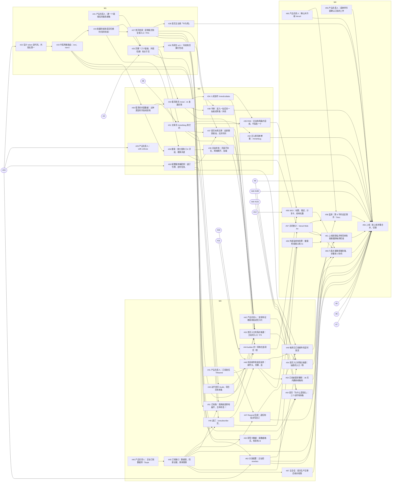

# 关口三 b：PRD v1.2 拆成规格和票

> 2026-11-09，主会话派的拆票 Agent 写；同日按关口三 b 冷审（`docs/delivery/reviews/2026-11-09-gate-3b.md`，就绪：否，P0 1、P1 8、P2 24）和主会话的决定改了第二轮；再按第二轮冷审（`docs/delivery/reviews/2026-11-09-gate-3b-r2.md`，就绪：否，新 P1 4、P2 16）改了第三轮。依据：PRD v1.2（在线第 269 版，快照 `docs/prd/velicoach.md`）、`docs/delivery/roadmap.md`（M1–M4）、`docs/uiue/coverage.md`、ADR-0001–0005、`docs/uiue/reviews/2026-11-04-ui-v1/closing.md` 的遗留项、`docs/prd/reviews/2026-11-09-pre-3b-r3.md` 留给票的 P2。做法照 `to-spec`、`to-tickets` 和 Veli `spec-quality.md` §2–§3，主站不同处见 `docs/standards/pipeline.md` §2.2。
> 本页记「拆成了什么、为什么这样拆」。票的正文以 GitHub 为准；关口三 b 是否通过由主会话在冷审后判，写在 #13。

## 1. 结论

**站点车道 4 份规格（#17–#20，每个里程碑一份）、47 张票（#21–#67）：36 张 `ready-for-agent`，11 张 `ready-for-human`（7 张等产品负责人，2 张由主会话做：配密钥 #63、首次生产迁移后核对权限 #67，1 张主会话和产品负责人一起做：上线 #66，1 张等 #65 升级 Pro 的自定事件 #58）；其中 10 张 `risk:high`。内容车道 #4–#12 补齐验收、按 PRD v1.2 核对正文，9 张都标 `ready-for-agent`；#5、#6、#7、#9、#10 用原生依赖等定数据格式的站点票。** 每张票都挂在所属规格下，卡点用 GitHub 原生的「被谁卡住」连好，包括跨仓库的 thin-muscle-coach#185、#101；切换那一刻 Veli 要做的事在 thin-muscle-coach#213（不用原生依赖连，由上线步骤引用）。PRD 的 v1 功能（P0、P1）每个都落到了票上，没有砍范围、没有改优先级；**这以升级 Vercel Pro 为前提**（#65，产品负责人已确认）；细则第 6 条的 IP 限流按实例计数，产品负责人已同意，PRD 第 269 版已写明（§6）。

本关口写了三份 ADR，产品负责人 2026-11-09 已确认，状态都是「已采纳」：ADR-0003 补 (c) 分流方式；ADR-0004 订阅的存储、发信、退订令牌和频率限制（按冷审 P0-1 改了权限模型）；ADR-0005 外部监控和告警（不加新服务商）。第三轮按第二轮冷审改了 ADR-0003 (b)(c)、ADR-0004 (a)(e)、ADR-0005 (a)(b)(c)。

### 第三轮改了什么（第二轮冷审之后）

| 第二轮冷审 | 改法 | 票和文件 |
|---|---|---|
| P1-1 工作流上线前跑不起来 | 迁移 `site-db-migrate`、监控 `site-monitor` 两个工作流文件由主会话的 `chore/` PR 先放进默认分支 `site`（迁移只能手动触发；监控的定时也写上，在 `site` 上才生效），票在 `feature/v1` 上补脚本，用 `ref=feature/v1` 手动触发；#40 删掉「首次迁移后安全顾问 0 问题」，新开 #67（`ready-for-human`，主会话）做首次生产迁移后的权限核对，被 #45 卡、卡 #66；#59 会话里触发不了的演练交主会话，告警邮件进关口四「合并前」；监控写的评论首行 `<!-- vc-bot role=监控 -->`；仓库公开，删除和导出不做成工作流（ADR-0004） | `.github/workflows/`、ADR-0004、ADR-0005、#40、#45、#59、#67 |
| P1-2 漏了 Veli 的静态资源 | 路由表 Veli 加一行：`/_next/*` 和 Veli 根目录的 `/manual/*`、`/sw.js`、`/manifest.webmanifest`、`/favicon.ico`、`/icons/*`（Veli `public/` 现在只有 `manual/`，其余是 F106 要加的）；#62 加 Playwright 网络检查（/body、/en/body、/app 的 4xx、5xx 为 0） | ADR-0003 (c)、`overview.md`、#62、thin-muscle-coach#185、#213 |
| P1-3 上线链没接上 | 写 `docs/delivery/launch-runbook.md`；`pipeline.md` §2.3 拆成「合并前」「切换后」；#66 改成 `ready-for-human`（主会话 + 产品负责人），正文按 runbook，去掉 `risk:high`；研究卡随外壳包发（包里带 `research.json`，Veli 从 git 依赖读），上线前 /body 就有数据；#185 按 ADR-0003 (c) 改写，切换时的事拆到新票 thin-muscle-coach#213；#54 改成在预览上验完就关，生产核对进 runbook | ADR-0003 (b)(c)、`deploy.md`、`pipeline.md` §2.3、#52、#54、#64、#66、#9、#42 |
| P1-4 告警 | 选 (a)：不加 Observability Plus；ADR-0005 (b) 改成错误照旧进每日日报，Pro 之后开 Vercel 内置异常检测告警作补充，不设次数阈值；#65 第 3 条改写；PRD「可观测性」一行的改法交主会话（PRD 不在本仓库改） | ADR-0005、#65、#59 |
| P2-1 占位符 | 规格 #17–#20 和 #45 的 24 处 `#{…}` 换成真实票号 | #17–#20、#45 |
| P2-2 过时的句子 | 「待产品负责人确认」「在线第 259 版」全部更新（ADR 已采纳、Pro 和 IP 限流已确认、第 269 版）；§1、§6、§9 改写 | 全部票、本页 |
| P2-3 #4 隐性等 M3 | 首屏数字先链原始出处，#9 合并后由 #64 改链到研究卡 | #4、#64 |
| P2-4 #38 不在上线上游 | #66 加原生依赖 #38 | #66 |
| P2-5 里程碑关口被等人的票挡住 | 推进器第 4 步：只等人或外部仓库的票不算开着的站点票，选票也看更早里程碑留下的 | `loops/site-runner.md`、`pipeline.md` §4 |
| P2-6 检查脚本和预置模块冲突 | 「读 `DATABASE_URL` 的地方」改成 `src/` 里除 `src/lib/db.ts`、`src/lib/auth/*` 外为 0，新模块不引用 `src/lib/db.ts` | ADR-0004、#45、#19 |
| P2-7 PGLite 上没有 `anon`、`authenticated` | 不存在就建同名的不能登录的角色 | ADR-0004、#45 |
| P2-8 删除命令在哪跑 | 产品负责人本机、`site_api` 的连接串，不做成工作流 | ADR-0004 (e)、#50 |
| P2-9 公开仓库的迁移工作流 | 只允许 `workflow_dispatch` 和 `push: site`；`SITE_DB_MIGRATE_URL` 放进部署分支只允许 `site`、`feature/v1` 的 Environment `site-db` | ADR-0004、#40、#45 |
| P2-10 监控的机器人标记和固定 issue | 首行 `<!-- vc-bot role=监控 -->`；可用率写进 issue「主站可用率」（号码存仓库变量），不用 #13 | ADR-0005、#59 |
| P2-11 健康检查和探测目标 | 结果缓存 30 秒；`MONITOR_TARGET` 合并后是生产部署的固定地址、切换后是 `velicoach.com` | ADR-0005 (c)、#59、runbook |
| P2-12 预览上测不了 Host 头 | 改成 `node --test` 对本地服务端发带 Host 头的请求 | #18、#32 |
| P2-13 #62 补三点 | `Location` 和登录回调不带 Veli 主机名；Veli 地址不在部署保护后面；Service Worker 作用范围限定 `/app`（#213） | #62、thin-muscle-coach#213 |
| P2-14 「连续 10 分钟」 | 规格 #20 用户故事 4 改成约 20 分钟 | #20 |
| P2-15 连接池的预编译语句 | 驱动关掉命名的预编译语句，加一条测试 | ADR-0004、#45 |
| P2-16 依赖漏洞的定时工作流 | 判定脚本用固定的 `npm audit` 输出测；定时上线后才跑 | #61 |
| 同类：构建里跑迁移 | #15 的 Vercel 构建命令去掉 `npm run db:migrate`，迁移只走工作流；`pipeline.md` §9 对照表、`deploy.md` 同步 | #15、`pipeline.md`、`deploy.md` |

### 第二轮改了什么（冷审之后）

| 冷审 | 改法 | 票 |
|---|---|---|
| P0-1 权限模型 | ADR-0004 (a) 重写：schema `site` 不对外暴露、`revoke all`、`site_api` 不带 `BYPASSRLS` 且按表写策略、运行时只读 `SITE_DB_URL`、迁移用只在 GitHub Actions 里的 `SITE_DB_MIGRATE_URL`、生产缺连接串返回 503、不碰沙箱契约 | #40、#45 |
| P1-1 ADR 状态 | ADR-0003、0004、0005 产品负责人 2026-11-09 已确认，都是「已采纳」；#40 写明确认 ADR-0004 后才开工，#26 写明确认 ADR-0003 后才开工 | #26、#40 |
| P1-2 取舍 | 新开 #65「确认并升级 Vercel Pro」，卡住 #58、#66；§6 改写 | #37、#49、#58、#65、#66 |
| P1-3 密钥和定时接口 | 新开 #63「配置服务端密钥」（主会话做），卡住 #37、#46、#49；两个定时接口加 `CRON_SECRET` 的 401 验收 | #37、#46、#49、#63 |
| P1-4 监控 | 写 ADR-0005；#59 按它改写，加 `risk:high`；线上错误进观察者日报（`docs/delivery/loops/observer.md` 已改） | #59 |
| P1-5 分流和隐性环 | ADR-0003 (c)：主站 rewrites 代理 Veli；#62 改成「分流配置并在预览域名上验证」（挪到 M3），新开 #66「上线切换根域名」 | #54、#60、#62、#66 |
| P1-6 会话里做不到的验收 | 改成测试、快照、脚本输出；真人才能做的移到 `docs/standards/pipeline.md` §2.3 关口四清单 | #25、#27、#29、#32、#35、#48、#54、#59 |
| P1-7 退订页语言 | 按地址：`/unsubscribe`、`/en/unsubscribe`（PRD 路由表已有两条） | #46、#48 |
| P1-8 内容数据格式 | 原生依赖 #5、#6、#7 ← #30，#10 ← #43，#9 ← #52；研究卡拆两张（#52 定格式和 JSON，#64 上首页），解开 #9 和 #52 的环；`pipeline.md` §4.1 加一行数据文件的归属 | #52、#64、内容票 |
| P2 | 能在票和文档里改的全改了（§8 末尾的表） | — |

## 2. 怎么拆的

- **竖切**：每张票从数据到页面到测试走通一条用户看得到的路，一次会话做得完。横切的只有一张地基票 #30（看清的内容数据），理由写在 #18 的「实现决定」：文章页、看清首页、RSS、搜索、站点地图读同一份数据，先做一次。
- **F01 拆三张**：PRD 定的是两张（M1 版式和入口；M3 落点接通）。落点接通再按「落在主站」和「落在 Veli」拆成 #53 和 #54：roadmap 的 M3 退出条件允许「除 /body 外已通过」，拆开以后 #53 不被 Veli 卡住，#54 用原生依赖连到 thin-muscle-coach#185、#101 和分流配置 #62。这是粒度的调整，不改需求。
- **分流两张**：#62 在 M3 配好 rewrites、在主站预览域名上验证，交付目标主机可换的核对脚本，#54 和端到端 #60 都在它之后；#66 是上线（`ready-for-human`，主会话 + 产品负责人，按 `docs/delivery/launch-runbook.md`），关口四的最后一张，原生依赖卡住上线要做完的站点票、内容票、律师确认、Vercel Pro 和 #67。Veli 切换时的事在 thin-muscle-coach#213。
- **研究卡两张**：#52 定源数据格式、校验和 `research.json`（写进外壳包给 Veli，也出公开的 `/data/research.json`；测试数据），#9 等它；#64 等 #9 和教练审核后上首页，并发外壳包的补丁版本。
- **F22 按页面拆**：文章页的四种状态在 #31，看清首页的内容加载失败在 #33，退订页在 #46，订阅失败在 #51，全站通用的页面不存在、网络断开、加载中在 #39。
- **外壳包按版本走**：v0.1 导航和页脚（#26，M1），之后书脊（#38，P1）和订阅条（#51，P0）各加一个版本；#51 不等 #38，谁先发谁取下一个版本号（冷审 P2-3）。
- **内容车道和站点车道的交汇**：站点票读 PRD 第 5 节的字段，用测试数据实现，不被内容票卡住；只有 PRD 写明「不用占位数据」或要内容先定模板的，才用原生依赖连到内容票：#25 等 #4（关于页文案），#31 等 #8（文章模板），#44 等 #10，#48 等 #11，#64 等 #9，#56 等 #12。反过来，内容票要填的数据文件由站点票先定格式：#5、#6、#7 等 #30，#10 等 #43，#9 等 #52（`docs/standards/pipeline.md` §4.1）。
- **每张界面票写明画板和状态**（画布「Velicoach 主站 · UI v1.0」v44）；没画的写明套用哪块画板的版式，这些套用的决定记在 `docs/uiue/decisions.md` 2026-11-09「关口三 b 拆票时定的体验细节」。

## 3. 里程碑 → 规格 → 票

「被谁卡住」里的 `thin-muscle-coach#…` 是 Veli 仓库的票。

### M1 · 规格 #17

| 票 | 标题 | 功能号 | 被谁卡住 | 车道 | 标签 |
|---|---|---|---|---|---|
| #21 | 产品负责人：建一个能收信的联系邮箱 | F16、F21、F23 | — | 站点 | `ready-for-human` `lane:site` |
| #22 | 设计 token 进代码，外观在第一次绘制就对 | F24 | #15 | 站点 | `ready-for-agent` `lane:site` |
| #23 | 中英两套路由：/en/、html lang、hreflang、第一次访问按浏览器语言 | F06 | #22 | 站点 | `ready-for-agent` `lane:site` |
| #24 | 胶囊导航和语言切换（外壳的导航） | F05、F06 | #23 | 站点 | `ready-for-agent` `lane:site` |
| #25 | 页脚（八个链接、外观切换）和关于页 /about | F21、F23、F24 | #24、#21、#4 | 站点 | `ready-for-agent` `lane:site` |
| #26 | 外壳包 v0.1：导航和页脚打包给 Veli | F05、F21 | #25 | 站点 | `ready-for-agent` `lane:site` |
| #27 | 首页首屏：双侧版式和全部入口（F01 第一张票） | F01 | #24 | 站点 | `ready-for-agent` `lane:site` |
| #28 | 首页主动效「叶与网」 | F01 | #27 | 站点 | `ready-for-agent` `lane:site` |

### M2 · 规格 #18

| 票 | 标题 | 功能号 | 被谁卡住 | 车道 | 标签 |
|---|---|---|---|---|---|
| #29 | 产品负责人：with.velicoach.com 的 DNS 指到主站 | F27 | #15 | 站点 | `ready-for-human` `lane:site` |
| #63 | 配置服务端密钥：退订令牌、定时任务、部署钩子（主会话做） | F03、F07 | #15 | 站点 | `ready-for-human` `lane:site` |
| #30 | 看清的内容数据：五种类型的字段校验和构建时索引 | F13、F14、F15、F16 的数据部分 | #23 | 站点 | `ready-for-agent` `lane:site` |
| #31 | 文章页 /mind/<slug> 和它的四种状态 | F16 | #30、#25、#8 | 站点 | `ready-for-agent` `lane:site` |
| #32 | 迁入原同席博客：/mind/<slug>、旁白文件和旧地址 301 | F27 | #31 | 站点 | `ready-for-agent` `lane:site` |
| #33 | 看清首页 /mind：AI 发展史按时代分组、类型筛选、学习路径 | F13、F14 | #30、#25 | 站点 | `ready-for-agent` `lane:site` |
| #34 | 人机协作 /mind/collaboration：范式分组、卡片标注、分段控件原地切换 | F15 | #33 | 站点 | `ready-for-agent` `lane:site` |
| #35 | RSS：全站和两条内容线、中英各一个源 | F25 | #31、#34 | 站点 | `ready-for-agent` `lane:site` |
| #36 | 搜索：放大镜和 ⌘K 浮层、搜索词进地址、按组出结果和操作 | F26 | #30、#24 | 站点 | `ready-for-agent` `lane:site` |
| #37 | 首页本周文章：由排期表驱动，北京时间周六 00:00 换 | F03 | #31、#27、#63 | 站点 | `ready-for-agent` `lane:site` `risk:high` |
| #38 | 书脊：进入一站后另一站收成窄条（外壳包 v0.2） | F08 | #33、#26 | 站点 | `ready-for-agent` `lane:site` |
| #39 | 全站状态：页面不存在、网络断开、加载中 | F22 | #36 | 站点 | `ready-for-agent` `lane:site` |

### M3 · 规格 #19

| 票 | 标题 | 功能号 | 被谁卡住 | 车道 | 标签 |
|---|---|---|---|---|---|
| #40 | 产品负责人：主站订阅数据库（Supabase 项目和两个连接串） | F07 | — | 站点 | `ready-for-human` `lane:site` |
| #41 | 产品负责人：订阅发信（Resend 子域名、DNS、追踪关闭、通讯地址、回调密钥） | F07 | — | 站点 | `ready-for-human` `lane:site` |
| #42 | 产品负责人：安排持证教练审核研究卡片和入门指南 | F02、F09 | — | 站点 | `ready-for-human` `lane:site` |
| #43 | 动手首页 /build、项目页和单条开发日志 | F19 | #31 | 站点 | `ready-for-agent` `lane:site` |
| #44 | builder 的一周和在造项目（首页 builder 区和动手页） | F18、F04 | #43、#10、#27、#37 | 站点 | `ready-for-agent` `lane:site` |
| #45 | 订阅接口：数据表、同意证据、频率限制、再提交规则 | F07 | #40 | 站点 | `ready-for-agent` `lane:site` `risk:high` |
| #46 | 退订：/unsubscribe 页、一键退订接口、令牌签名和失效 | F07 | #45、#25、#63 | 站点 | `ready-for-agent` `lane:site` `risk:high` |
| #47 | Resend 回调：退信和投诉写回订阅表 | F07 | #45、#41 | 站点 | `ready-for-agent` `lane:site` `risk:high` |
| #48 | 欢迎邮件和发信组件：邮件头、页脚、追踪关闭 | F07 | #46、#41、#11 | 站点 | `ready-for-agent` `lane:site` `risk:high` |
| #49 | 每周日订阅邮件的定时发送 | F07 | #48、#47、#63 | 站点 | `ready-for-agent` `lane:site` `risk:high` |
| #50 | 订阅者要求删除：30 天内删掉邮箱和同意证据 | F07 | #48 | 站点 | `ready-for-agent` `lane:site` `risk:high` |
| #51 | 订阅条：首屏底部原地展开、五种状态（外壳包 v0.3） | F07 | #45、#36、#27 | 站点 | `ready-for-agent` `lane:site` `risk:high` |
| #52 | 研究卡数据：源数据格式、校验和 /data/research.json | F02、F09 的数据 | #23 | 站点 | `ready-for-agent` `lane:site` |
| #64 | 首页「为什么是现在」：三个动作和四条研究（F02） | F02 | #9、#42、#27、#52 | 站点 | `ready-for-agent` `lane:site` |
| #53 | 首页入口的落点接通：主站的入口（F01 第二张票） | F01 | #37、#33、#34、#31、#43、#51、#39 | 站点 | `ready-for-agent` `lane:site` |
| #54 | 首页入口的落点接通：站稳的入口（等 Veli） | F01 | #53、thin-muscle-coach#185、thin-muscle-coach#101、#62 | 站点 | `ready-for-agent` `lane:site` |
| #62 | 分流配置：主站用 rewrites 代理 Veli 的路径，在预览域名上验证 | PRD 第 3 节路由表 | #15、#23 | 站点 | `ready-for-agent` `lane:site` `risk:high` |
| #67 | 主会话：首次生产迁移后核对权限（site_api、公开角色、安全顾问） | F07 | #45 | 站点 | `ready-for-human` `lane:site` |

### M4 · 规格 #20

| 票 | 标题 | 功能号 | 被谁卡住 | 车道 | 标签 |
|---|---|---|---|---|---|
| #55 | 产品负责人：请律师书面确认订阅的三件事和「授权与确认」表 | F07、F21 | — | 站点 | `ready-for-human` `lane:site` |
| #65 | 产品负责人：确认并升级 Vercel Pro | F29 | — | 站点 | `ready-for-human` `lane:site` |
| #56 | SEO：标题、描述、分享卡、结构化数据、站点地图和 robots | F28 | #12、#35、#44 | 站点 | `ready-for-agent` `lane:site` |
| #57 | 访问统计：Vercel Web Analytics、来源、机器人分开（不含自定事件） | F29 | #46、#36 | 站点 | `ready-for-agent` `lane:site` |
| #58 | 监测：第 6 节的自定事件（等 #65 升级 Vercel Pro） | F29 | #57、#45、#65 | 站点 | `ready-for-human` `lane:site` |
| #59 | 外部监控和告警：健康检查接口和 GitHub Actions 定时探测（ADR-0005） | F29 | #45、#48 | 站点 | `ready-for-agent` `lane:site` `risk:high` |
| #60 | 六条关键路径端到端、步数和 1 秒的量法、axe、Lighthouse | PRD「关键路径与页面状态」P1–P6、「步数预算」「怎么验收」 | #54、#56、#57、#62 | 站点 | `ready-for-agent` `lane:site` |
| #61 | 上线前隐私评审清单和依赖漏洞每周检查 | PRD 第 8 节「隐私」「安全」 | #57、#59、#50 | 站点 | `ready-for-agent` `lane:site` |
| #66 | 上线：按上线步骤合并、切换 velicoach.com（主会话 + 产品负责人） | PRD 第 3 节路由表 | #60、#61、#55、#65、thin-muscle-coach#185、#62、#28、#32、#38、#39、#47、#49、#64、#58、#67、#5、#6、#7、#9 | 站点 | `ready-for-human` `lane:site` |

### 内容车道（总票 #3）

| 票 | 标题 | 功能号 | 被谁卡住 | 车道 | 标签 | 谁在等它 |
|---|---|---|---|---|---|---|
| #4 | 首页与三站入口文案 | F01–F04、F23；T09 | — | 内容 | `ready-for-agent` `lane:content` | #25 |
| #5 | 看清：AI 发展史（里程碑） | F13；T06 | #30 | 内容 | `ready-for-agent` `lane:content` | #33、#66 |
| #6 | 看清：学习路径 | F14；T03、T04 | #30 | 内容 | `ready-for-agent` `lane:content` | #33、#66 |
| #7 | 看清：人机协作（选文与工程范式） | F15；T01、T02、T05、T13–T16 | #30 | 内容 | `ready-for-agent` `lane:content` | #34、#66 |
| #8 | 文章模板与 3 分钟视频 | F16、F22 | — | 内容 | `ready-for-agent` `lane:content` | #31 |
| #9 | 站稳：研究卡片与入门指南 | F02、F09；T07、T08 | #52；合并前等 #42（持证教练） | 内容 | `ready-for-agent` `lane:content` | #64、#66、thin-muscle-coach#185 |
| #10 | 动手：开发日志与方法 | F18、F19；T10 | #43 | 内容 | `ready-for-agent` `lane:content` | #44 |
| #11 | 订阅邮件与每周分发 | F07；T11、T18 | — | 内容 | `ready-for-agent` `lane:content` | #48、#51 |
| #12 | 术语、英文版与 SEO | F28；T09、T17 | — | 内容 | `ready-for-agent` `lane:content` | #56 |

内容票改了什么：每张加了 `<!-- vc-bot role=拆票 -->` 首行、依据的 PRD 版本、按 PRD v1.2 改正的地方（#4「动手」圆的叫法、builder 区和关于页；#6、#7 不再自己列字段，改成「按 PRD 第 5 节某一行的全部字段」；#7 加范式和工具与技能卡片；#8 加原文日期和收录日期、合成旁白的标识；#9 首批四张按 PRD 的四个主题；#11 加订阅的全部界面文案和欢迎邮件；#12 定标题和描述的长度），以及「谁在等它」。第二轮：#5、#6、#7、#9、#10 加「被谁卡住」和原生依赖；#4、#12 把页面上才判得了的两条改成由站点票 #53、#60 核对，#4 加「首屏数字链到 #9 的出处」；#8 加字幕和文字稿。

**#9 为什么标 `ready-for-agent` 而不是 `ready-for-human`**：起草研究卡和入门指南不用等人（只等 #52 定格式）；要等的是合并前的持证教练审核记录。这一步单独开了 #42（`ready-for-human`），#9 正文写明「合并前等 #42」，PR 打 `owner:merge`，合并脚本不自动合并带这个标签的 PR，审核记录贴齐后由产品负责人合并。#9 没有用原生依赖连 #42，否则推进器会认为它不能开工。

## 4. 依赖图

虚线框是 `ready-for-human` 的票；圆角的是外部的票（本仓库的 #15、内容票，和 Veli 仓库的票）。

## 5. 卡在外部的票

| 卡点 | 谁来解 | 票 | 直接卡住 |
|---|---|---|---|
| 流水线开跑前的准备（Vercel 项目、预览绕过头、基线变绿、合并脚本） | 产品负责人 + 主会话 | #15 | #22（站点车道第一张）、#29、#62、#63 |
| ADR-0003、ADR-0004、ADR-0005 已确认（2026-11-09）| 产品负责人 | 已解除 | #26、#40 可以开工；#59 依据 ADR-0005 |
| 两个工作流文件放进默认分支 `site`（迁移只能手动触发，监控带定时） | 主会话（`chore/` PR，产品负责人合并） | 无票 | #45、#59 的手动触发，#67 |
| Veli：/body、/en/body、法务页、研究卡从外壳包读、接入外壳包、路由表同步 | Veli 仓库 | thin-muscle-coach#185 | #54、#66；#25 的法务链接落点（不挡关票） |
| Veli：切换那一刻的事（去掉 `/` 的临时跳转、不出 robots.txt、ADR-0032 改成由主站代理、Service Worker 作用范围） | Veli 仓库 + 主会话 | thin-muscle-coach#213 | 不用原生依赖连；在 #66 的「切换」一步合并 |
| 首次生产迁移后核对权限 | 主会话 | #67 | #66 |
| Veli：/body 按两步原则改 | Veli 仓库 | thin-muscle-coach#101 | #54 |
| 联系邮箱 | 产品负责人 | #21 | #25 |
| with.velicoach.com 的 DNS | 产品负责人 | #29 | 上线后的跳转核对（关口四清单） |
| 退订令牌密钥、`CRON_SECRET`、部署钩子 | 主会话（用 Vercel 的环境变量接口生成并写入，不打印值） | #63 | #37、#46、#49 |
| 主站订阅数据库（Supabase 项目、`site_api`、两个连接串、Environment `site-db`） | 产品负责人 | #40 | #45，进而整条订阅链 |
| Resend 子域名、DNS、追踪关闭、回调密钥、CAN-SPAM 通讯地址 | 产品负责人 | #41 | #47、#48 |
| 持证教练审核 | 产品负责人安排 | #42 | #64；#9 的合并 |
| 律师书面确认（细则第 14 条三件事、「授权与确认」表） | 产品负责人请律师 | #55 | #66 |
| Vercel Pro（已确认，待升级） | 产品负责人 | #65 | #58、#66；#37、#49 的准点 |
| 上线：合并 `feature/v1` → `site`、切换域名 | 主会话 + 产品负责人 | #66 | — |

## 6. 涉及需求取舍的地方

**没有砍范围，没有改优先级；前提是上线前升级 Vercel Pro。** PRD 的 v1 P0、P1 都在票里（§7），P2（F12、F17、F20）不开票。下面四条产品负责人都已知道或已定：

1. **IP 频率限制按实例计数，改了细则第 6 条的验收；产品负责人 2026-11-09 已同意，PRD 细则第 6 条已写明（在线第 269 版）。** ADR-0004 (d) 只用内存计数（不加新服务商），Vercel 同时起多个实例时，同一 IP 实际能提交的次数会多于 5 次；同一邮箱每小时 3 次照样准确。Pro 生效后可以在 Vercel 防火墙加同样的规则作为第二道；上线两周后观察者按 Resend 的退信和投诉数复核。
2. **Vercel Pro：产品负责人 2026-11-09 确认上线前升级，#65 只剩升级这一步。** PRD 第 8 节「成本」已写上线前升级 Pro；#65 负责这件事，原生依赖卡住 #58（F29 的自定事件，P0）和上线切换 #66。不升级时，F29 的事件要按 PRD 第 10 节的替代（主站自己的接口收事件）先改 PRD。
3. **两个定时的准点也依赖 Pro。** Hobby 的定时任务精度是一小时内：#49 周日 08:00 发信、#37 北京时间周六 00:00 换本周文章（加上构建时间），在 Hobby 上会晚到最多约一小时。两张票都写明了；上线后第一周由观察者核对实际时刻。
4. **错误告警不加 Observability Plus（第二轮冷审 P1-4，主会话选 (a)）。** Vercel 按次数设阈值的告警要另付这一项；线上错误照旧进每日日报，Pro 之后开 Vercel 内置的异常检测告警作补充，整站挂了由外部探测约 20 分钟告警（ADR-0005）。PRD「可观测性」一行要跟着改，改法交主会话（§9）。

下面几处是体验类决定（主会话直接定，产品负责人有意见再改），记在 `docs/uiue/decisions.md`：主站的 `/mind`、`/build` 不放本站操作条；手机上不显示书脊；没画的界面套用已有画板。

## 7. 功能 → 票

| 功能 | 票 |
|---|---|
| F01 双侧首屏 | #27 版式和入口、#28 动效、#53 主站落点、#54 站稳落点 |
| F02 为什么是现在 | #52 数据格式和 JSON、#64 上首页 |
| F03 本周文章 | #37 |
| F04 builder 区（P1） | #44 |
| F05 胶囊导航 | #24、#26 |
| F06 中英切换 | #23、#24 |
| F07 订阅 | #45、#46、#47、#48、#49、#50、#51；人：#40、#41、#55、#63、#67 |
| F08 书脊（P1） | #38 |
| F09–F11 站稳 | Veli 仓库（thin-muscle-coach#185、#101）；研究卡数据 #52 |
| F13 AI 发展史、F14 学习路径 | #33 |
| F15 人机协作 | #34 |
| F16 文章页 | #31 |
| F18 builder 的一周（P1） | #44 |
| F19 开发日志 | #43 |
| F21 页脚与法务页 | #25、#26；法务正文在 Veli |
| F22 空状态与错误页 | #31、#33、#39、#46、#51 |
| F23 关于与联系 | #25；人：#21 |
| F24 浅色与深色 | #22、#25、#36 |
| F25 RSS | #35 |
| F26 搜索 | #36（「订阅」操作在 #51） |
| F27 迁移与跳转 | #32；人：#29；生产核对在 #66 和关口四 |
| F28 SEO | #56 |
| F29 监测 | #57、#58、#59；人：#65 |
| 第 8 节非功能（性能、多端、无障碍、可靠性、隐私、安全） | #60、#61，以及各票验收里的对应条（字体自托管 #22、地区格式 #23、200% 字号 #60） |
| 分流和上线 | #62 配置、预览验证和核对脚本；#66 上线（按 `launch-runbook.md`）；Veli 侧 thin-muscle-coach#213 |

## 8. 遗留项的去处

| 来源 | 项 | 票 |
|---|---|---|
| 关口三 a | N1 英文 320×568「动手」圆压字 | #27 |
| 关口三 a | S2 手机上两处登录按钮外观不同、S3 Esc 挂在展开层上 | #27 |
| 关口三 a | S4 手机上视频出错的说明被藏 | #31 |
| 关口三 a | S6 英文 320 分段控件被裁 | #34 |
| 关口三 a | S8 不吸顶的导航用玻璃 | #24 |
| 关口三 a | 折叠屏和平板的 WebGL 静态兜底 | #28 |
| 关口三 a | 原文日期和收录日期分开 | #30（数据）、#8（显示在哪） |
| 关口三 a | L1「动手」圆跟着接缝和铰链 | #27 |
| 关口三 a | L2 Safari、Firefox 真机上的吸顶模糊 | #24 记进关口四的真机清单 |
| 关口三 a | L3 样式数值换成 token | #22 |
| 关口三 a | L4 语言进地址、往返测试 | #23 |
| 关口三 a | L5 站点地图、RSS、结构化数据由内容数据生成 | #30、#35、#56 |
| 关口三 a | L6 `feynman-film` 的点击换成 `button`、`jsx-a11y` | #31 |
| 关口三 a | L7 机器人和人分开统计 | #57 |
| 第三轮冷审 P2-1 | F28 旧文章例外、robots 覆盖 Veli | #56 |
| 第三轮冷审 P2-2 | F29 测试告警 | #59、关口四清单 |
| 第三轮冷审 P2-4 | 退订落点、令牌签名和失效 | ADR-0004 (c)、#46 |
| 第三轮冷审 P2-5 | F05 和本站操作条；/mind、/build 要不要操作条 | #24；`decisions.md` |
| 第三轮冷审 P2-6 | 同一存储键和绘制前设主题、token CSS 交给 Veli、落后版本的检查 | #22、#26 |
| 第三轮冷审 P2-9 | 内容票不再重复列字段 | #5、#6、#7 |
| 第三轮冷审 P2-10 | 「动手」圆和「然后动手」 | `decisions.md`、#4 |
| 第三轮冷审 P2-12 | F02 跟哪个里程碑 | #52、#64（M3） |
| 第三轮冷审 P2-13 | 关于页文案的内容任务 | #4 |

关口三 b 冷审的 P2（`docs/delivery/reviews/2026-11-09-gate-3b.md`）：

| P2 | 改法 |
|---|---|
| 1 上线票的上游 | #66 直接卡住 #28、#32、#39、#47、#49、#58、#64 和内容 #5、#6、#7、#9 |
| 2 缺的直接依赖 | #44 加 #27、#37；#51 加 #27；#53 加 #39 |
| 3 #51 被 P1 卡住 | 去掉 #51 ← #38，外壳包版本号谁先发谁取下一个 |
| 4 共享位置 | #27、#36、#39 写明根布局、首页路由，和改入口文件的票排队 |
| 5 `last_issue_sent` | ADR-0004 加字段；#47、#49 按它算 |
| 6 预览的多实例 PGLite | ADR-0004 (a)、S3 规格、#45、#46：跨请求的状态只在 `node --test` 里测 |
| 7 预览的测试密钥 | #63 给 Preview 单独一个值；#46 写明 |
| 8 公开接口被拒在 PGLite 上测不了 | #45 在 PGLite 里建 `anon`、`authenticated` 角色断言；生产上的核对第三轮挪到 #67 |
| 9 删除和 Resend 日志、同意证据的查询 | ADR-0004 (e)、#50 改写：保留期超过 30 天是需求偏差，交产品负责人和律师；运行手册加查询命令 |
| 10 Supabase 暂停和连接池 | ADR-0004「后果」、#40 |
| 11 #62 加 `risk:high` | #62、#66 都加了 |
| 12 #23 的字符串检查 | 旧文件先列进豁免名单 |
| 13 折叠屏不重新加载 | #27 加 U13 |
| 14 三处没人认领的 PRD 要求 | 字体自托管 #22、日期和数字的地区格式 #23、200% 字号 #60 |
| 15 无界面票的理由 | #57、#58、#59 写了理由 |
| 16 三个项目 | #44 改成 Veli、看清的文章库、智能体技能库 |
| 17 各里程碑的统计事件 | 规格 #17、#18、#19 各写一条事件清单；#58 写明一次做不完就按页面拆 |
| 18 内容票判不了的两条 | #4、#12 改成由站点票 #53、#60 核对 |
| 19 首屏数字的出处 | #4 加一条 |
| 20 字幕 | #8 加一条 |
| 21 `owner:merge` 不被自动合并 | #9 写明 |
| 22 deploy.md 的 308 | 改成 301（PRD F27），分流改成 ADR-0003 (c) |
| 23 roadmap §4 的顺序 | 按票里的方向改了，加数据格式一行 |
| 24 过时的文字 | 拆分说明 §9、`pipeline.md` §2 的关口表已改；#13 正文由日报覆盖，主会话下次更新时改 |

## 9. 给主会话的

- 开一个 `chore/` PR 把 `.github/workflows/site-db-migrate.yml`、`site-monitor.yml` 放进 `site`（拆票会话写好了文件，但推送工作流要 `workflows` 权限，没有提交在本分支；由主会话或产品负责人提交）；合并以后 #45、#59、#67 才能用 `ref=feature/v1` 手动触发。
- #63 由主会话做：#15 建好 Vercel 项目以后，用 Vercel 的环境变量接口生成并写入，不打印值。#67 由主会话做：#45 合并后触发迁移并核对。
- #66 按 `docs/delivery/launch-runbook.md` 做；Veli 侧切换时的事在 thin-muscle-coach#213。
- #13 正文由日报覆盖，主会话下次更新时把关口三 b 第三轮的结果写进去。
- 要改在线 PRD 的地方（本仓库不改 PRD；第 269 版已经改了监控频率、IP 按实例计数、分流写法、Pro 的理由）：
  1. 第 8 节「可观测性」验收：Pro 之后的告警改成「错误照旧进每日日报，Pro 之后加开 Vercel 内置异常告警作补充，不设次数阈值」（ADR-0005 (b)）。
  2. 第 5 节之后的决定记录「研究卡数据放在哪」和第 11 节「Veli 站稳页」一行：Veli 从外壳包读 `research.json`，不再构建时请求 `/data/research.json`、读不到用快照（ADR-0003 (b)）。
  3. 细则第 10 条和第 8 节「隐私」第二行：Resend 发送日志的保留期如果超过 30 天，要写明例外（等 #50 查明）。
  4. 第 8 节「隐私」验收的第三方清单：加 GitHub（监控，只收探测结果）。
  5. 第 6 节「上线前检查」或第 9 节：引用 `docs/standards/pipeline.md` §2.3 关口四的「合并前」「切换后」两段和 `docs/delivery/launch-runbook.md`。
- `/unsubscribe`、`/en/unsubscribe` 两条在 PRD 路由表里已经都有，不用改。

## 10. 检查

- 4 份规格、47 张票、9 张内容票的正文，发出前都先存成文件跑 `node scripts/check-vague.mjs <文件>`，全部通过（拆票脚本逐份跑，不过就不发）。第二轮、第三轮同样逐份重跑；第三轮还跑了 #15 和 thin-muscle-coach#185、#213 的正文。
- 第三轮：原生依赖（#3–#67）建图没有环；以父规格定里程碑，倒挂 0 处；#21–#67 都挂在规格下。
- 仓库里 `npm run check:vague`、`npm run check:terms` 在提交前跑过，结果见提交说明。
