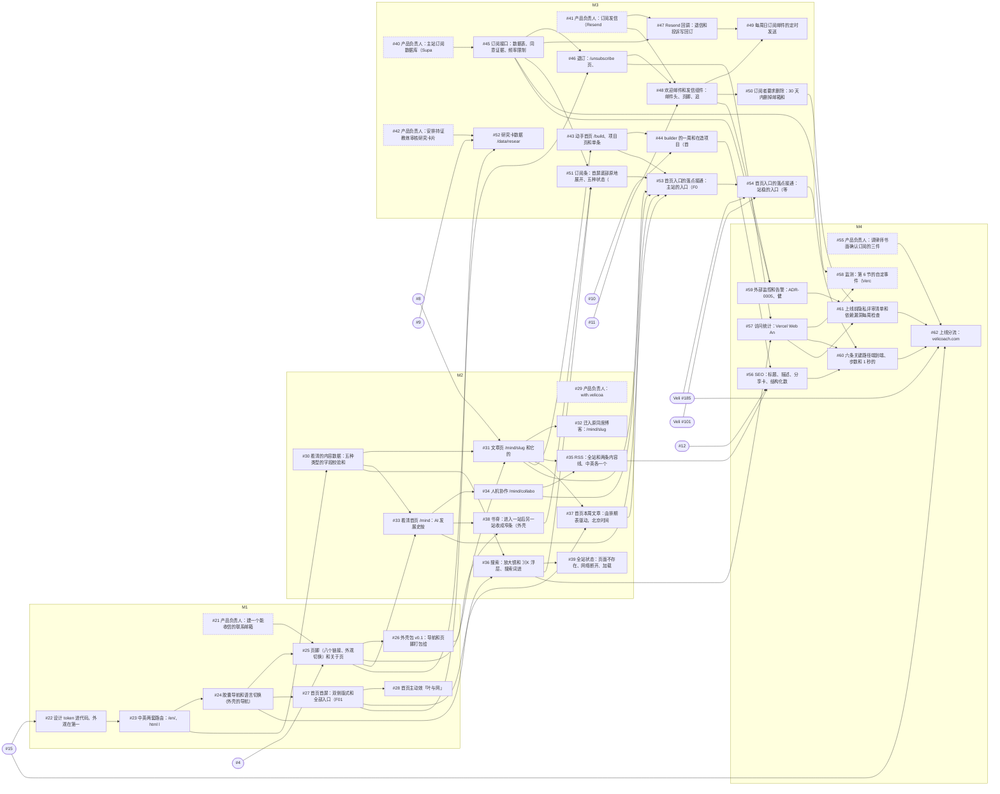

# 关口三 b：PRD v1.2 拆成规格和票

> 2026-11-09，主会话派的拆票 Agent 写。依据：PRD v1.2（在线第 259 版，快照 `docs/prd/velicoach.md`）、`docs/delivery/roadmap.md`（M1–M4）、`docs/uiue/coverage.md`、ADR-0001–0004、`docs/uiue/reviews/2026-11-04-ui-v1/closing.md` 的遗留项、`docs/prd/reviews/2026-11-09-pre-3b-r3.md` 留给票的 P2。做法照 `to-spec`、`to-tickets` 和 Veli `spec-quality.md` §2–§3，主站不同处见 `docs/standards/pipeline.md` §2.2。
> 本页记「拆成了什么、为什么这样拆」。票的正文以 GitHub 为准；关口三 b 是否通过由主会话在冷审后判，写在 #13。

## 1. 结论

**站点车道 4 份规格（#17–#20，每个里程碑一份）、42 张票（#21–#62）：35 张 `ready-for-agent`，7 张 `ready-for-human`（6 张等产品负责人做的事，1 张是 Vercel 套餐确认前不开工的自定事件）；其中 8 张 `risk:high`（订阅、发信、表单和部署钩子密钥）。内容车道 #4–#12 补齐验收、按 PRD v1.2 核对正文，9 张都标 `ready-for-agent`。** 每张票都挂在所属规格下（子议题），卡点用 GitHub 原生的「被谁卡住」连好，包括跨仓库的 thin-muscle-coach#185、#101。PRD 的 v1 功能（P0、P1）每个都落到了票上；没有砍范围，也没有改优先级，有两处实现上的取舍要产品负责人知道（§6）。

另外写了 ADR-0004（订阅的存储、发信、退订令牌和频率限制），PRD「订阅的细则」第 8、9 条要求在关口三 b 定。监控和告警的 ADR-0005 交给 #59 先写再接通，工具选型的约束写在票里。

## 2. 怎么拆的

- **竖切**：每张票从数据到页面到测试走通一条用户看得到的路，一次会话做得完。横切的只有一张地基票 #30（看清的内容数据），理由写在 #18 的「实现决定」：文章页、看清首页、RSS、搜索、站点地图读同一份数据，先做一次。
- **F01 拆三张**：PRD 定的是两张（M1 版式和入口；M3 落点接通）。落点接通再按「落在主站」和「落在 Veli」拆成 #53 和 #54：roadmap 的 M3 退出条件允许「除 /body 外已通过」，拆开以后 #53 不被 Veli 卡住，#54 用原生依赖连到 thin-muscle-coach#185、#101。这是粒度的调整，不改需求。
- **F22 按页面拆**：文章页的四种状态在 #31，看清首页的内容加载失败在 #33，退订页在 #46，订阅失败在 #51，全站通用的页面不存在、网络断开、加载中在 #39。
- **外壳包按版本走**：v0.1 导航和页脚（#26，M1）、v0.2 书脊（#38，M2）、v0.3 订阅条（#51，M3），和 ADR-0003 (b) 一致；#51 依赖 #38，保证版本号按顺序升。
- **内容车道和站点车道的交汇**：站点票读 PRD 第 5 节的字段，用测试数据实现，不被内容票卡住；只有 PRD 写明「不用占位数据」或要内容先定模板的，才用原生依赖连到内容票：#25 等 #4（关于页文案），#31 等 #8（文章模板），#44 等 #10，#48 等 #11，#52 等 #9，#56 等 #12。
- **每张界面票写明画板和状态**（画布「Velicoach 主站 · UI v1.0」v44）；没画的写明套用哪块画板的版式，这些套用的决定记在 `docs/uiue/decisions.md` 2026-11-09「关口三 b 拆票时定的体验细节」。

## 3. 里程碑 → 规格 → 票

「被谁卡住」里的 `thin-muscle-coach#…` 是 Veli 仓库的票。

### M1 · 规格 #17

| 票 | 标题 | 功能号 | 被谁卡住 | 车道 | 标签 |
|---|---|---|---|---|---|
| #21 | 产品负责人：建一个能收信的联系邮箱 | F16、F21、F23 | — | 站点 | `ready-for-human` `lane:site` |
| #22 | 设计 token 进代码，外观在第一次绘制就对 | F24 | #15 | 站点 | `ready-for-agent` `lane:site` |
| #23 | 中英两套路由：/en/、html lang、hreflang、第一次访问按浏览器语言 | F06 | #22 | 站点 | `ready-for-agent` `lane:site` |
| #24 | 胶囊导航和语言切换（外壳的导航） | F05、F06 | #23 | 站点 | `ready-for-agent` `lane:site` |
| #25 | 页脚（八个链接、外观切换）和关于页 /about | F21、F23、F24 | #24、#21、#4 | 站点 | `ready-for-agent` `lane:site` |
| #26 | 外壳包 v0.1：导航和页脚打包给 Veli | F05、F21 | #25 | 站点 | `ready-for-agent` `lane:site` |
| #27 | 首页首屏：双侧版式和全部入口（F01 第一张票） | F01 | #24 | 站点 | `ready-for-agent` `lane:site` |
| #28 | 首页主动效「叶与网」 | F01 | #27 | 站点 | `ready-for-agent` `lane:site` |

### M2 · 规格 #18

| 票 | 标题 | 功能号 | 被谁卡住 | 车道 | 标签 |
|---|---|---|---|---|---|
| #29 | 产品负责人：with.velicoach.com 的 DNS 指到主站 | F27 | — | 站点 | `ready-for-human` `lane:site` |
| #30 | 看清的内容数据：五种类型的字段校验和构建时索引 | F13、F14、F15、F16 的数据部分 | #23 | 站点 | `ready-for-agent` `lane:site` |
| #31 | 文章页 /mind/<slug> 和它的四种状态 | F16 | #30、#25、#8 | 站点 | `ready-for-agent` `lane:site` |
| #32 | 迁入原同席博客：/mind/<slug>、旁白文件和旧地址 301 | F27 | #31 | 站点 | `ready-for-agent` `lane:site` |
| #33 | 看清首页 /mind：AI 发展史按时代分组、类型筛选、学习路径 | F13、F14 | #30、#25 | 站点 | `ready-for-agent` `lane:site` |
| #34 | 人机协作 /mind/collaboration：范式分组、卡片标注、分段控件原地切换 | F15 | #33 | 站点 | `ready-for-agent` `lane:site` |
| #35 | RSS：全站和两条内容线、中英各一个源 | F25 | #31、#34 | 站点 | `ready-for-agent` `lane:site` |
| #36 | 搜索：放大镜和 ⌘K 浮层、搜索词进地址、按组出结果和操作 | F26 | #30、#24 | 站点 | `ready-for-agent` `lane:site` |
| #37 | 首页本周文章：由排期表驱动，北京时间周六 00:00 换 | F03 | #31、#27 | 站点 | `ready-for-agent` `lane:site` `risk:high` |
| #38 | 书脊：进入一站后另一站收成窄条（外壳包 v0.2） | F08 | #33、#26 | 站点 | `ready-for-agent` `lane:site` |
| #39 | 全站状态：页面不存在、网络断开、加载中 | F22 | #36 | 站点 | `ready-for-agent` `lane:site` |

### M3 · 规格 #19

| 票 | 标题 | 功能号 | 被谁卡住 | 车道 | 标签 |
|---|---|---|---|---|---|
| #40 | 产品负责人：主站订阅数据库（Supabase 项目和两个连接串） | F07 | — | 站点 | `ready-for-human` `lane:site` |
| #41 | 产品负责人：订阅发信（Resend 子域名、DNS、追踪关闭、通讯地址、回调密钥） | F07 | — | 站点 | `ready-for-human` `lane:site` |
| #42 | 产品负责人：安排持证教练审核研究卡片和入门指南 | F02、F09 | — | 站点 | `ready-for-human` `lane:site` |
| #43 | 动手首页 /build、项目页和单条开发日志 | F19 | #31 | 站点 | `ready-for-agent` `lane:site` |
| #44 | builder 的一周和在造项目（首页 builder 区和动手页） | F18、F04 | #43、#10 | 站点 | `ready-for-agent` `lane:site` |
| #45 | 订阅接口：数据表、同意证据、频率限制、再提交规则 | F07 | #40 | 站点 | `ready-for-agent` `lane:site` `risk:high` |
| #46 | 退订：/unsubscribe 页、一键退订接口、令牌签名和失效 | F07 | #45、#25 | 站点 | `ready-for-agent` `lane:site` `risk:high` |
| #47 | Resend 回调：退信和投诉写回订阅表 | F07 | #45、#41 | 站点 | `ready-for-agent` `lane:site` `risk:high` |
| #48 | 欢迎邮件和发信组件：邮件头、页脚、追踪关闭 | F07 | #46、#41、#11 | 站点 | `ready-for-agent` `lane:site` `risk:high` |
| #49 | 每周日订阅邮件的定时发送 | F07 | #48、#47 | 站点 | `ready-for-agent` `lane:site` `risk:high` |
| #50 | 订阅者要求删除：30 天内删掉邮箱和同意证据 | F07 | #48 | 站点 | `ready-for-agent` `lane:site` `risk:high` |
| #51 | 订阅条：首屏底部原地展开、五种状态（外壳包 v0.3） | F07 | #45、#36、#38 | 站点 | `ready-for-agent` `lane:site` `risk:high` |
| #52 | 研究卡数据 /data/research.json 和首页「为什么是现在」 | F02 | #9、#42、#27 | 站点 | `ready-for-agent` `lane:site` |
| #53 | 首页入口的落点接通：主站的入口（F01 第二张票） | F01 | #37、#33、#34、#31、#43、#51 | 站点 | `ready-for-agent` `lane:site` |
| #54 | 首页入口的落点接通：站稳的入口（等 Veli） | F01 | #53、thin-muscle-coach#185、thin-muscle-coach#101 | 站点 | `ready-for-agent` `lane:site` |

### M4 · 规格 #20

| 票 | 标题 | 功能号 | 被谁卡住 | 车道 | 标签 |
|---|---|---|---|---|---|
| #55 | 产品负责人：请律师书面确认订阅的三件事和「授权与确认」表 | F07、F21 | — | 站点 | `ready-for-human` `lane:site` |
| #56 | SEO：标题、描述、分享卡、结构化数据、站点地图和 robots | F28 | #12、#35、#44 | 站点 | `ready-for-agent` `lane:site` |
| #57 | 访问统计：Vercel Web Analytics、来源、机器人分开（不含自定事件） | F29 | #46、#36 | 站点 | `ready-for-agent` `lane:site` |
| #58 | 监测：第 6 节的自定事件（Vercel 套餐由产品负责人确认前不开工） | F29 | #57、#45 | 站点 | `ready-for-human` `lane:site` |
| #59 | 外部监控和告警：ADR-0005、健康检查接口、每 5 分钟探测 | F29 | #45、#48 | 站点 | `ready-for-agent` `lane:site` |
| #60 | 六条关键路径端到端、步数和 1 秒的量法、axe、Lighthouse | PRD「关键路径与页面状态」P1–P6、「步数预算」「怎么验收」 | #54、#56、#57 | 站点 | `ready-for-agent` `lane:site` |
| #61 | 上线前隐私评审清单和依赖漏洞每周检查 | PRD 第 8 节「隐私」「安全」 | #57、#59、#50 | 站点 | `ready-for-agent` `lane:site` |
| #62 | 上线分流：velicoach.com 按路径交给主站和 Veli | PRD 第 3 节路由表 | #60、#61、#55、#15、thin-muscle-coach#185 | 站点 | `ready-for-agent` `lane:site` |

### 内容车道（总票 #3）

| 票 | 标题 | 功能号 | 被谁卡住 | 车道 | 标签 | 谁在等它 |
|---|---|---|---|---|---|---|
| #4 | 首页与三站入口文案 | F01–F04、F23；T09 | — | 内容 | `ready-for-agent` `lane:content` | #25 |
| #5 | 看清：AI 发展史（里程碑） | F13；T06 | — | 内容 | `ready-for-agent` `lane:content` | #33 上线的内容 |
| #6 | 看清：学习路径 | F14；T03、T04 | — | 内容 | `ready-for-agent` `lane:content` | #33 上线的内容 |
| #7 | 看清：人机协作（选文与工程范式） | F15；T01、T02、T05、T13–T16 | — | 内容 | `ready-for-agent` `lane:content` | #34 上线的内容 |
| #8 | 文章模板与 3 分钟视频 | F16、F22 | — | 内容 | `ready-for-agent` `lane:content` | #31 |
| #9 | 站稳：研究卡片与入门指南 | F02、F09；T07、T08 | 合并前等 #42（持证教练） | 内容 | `ready-for-agent` `lane:content` | #52、thin-muscle-coach#185 |
| #10 | 动手：开发日志与方法 | F18、F19；T10 | — | 内容 | `ready-for-agent` `lane:content` | #44 |
| #11 | 订阅邮件与每周分发 | F07；T11、T18 | — | 内容 | `ready-for-agent` `lane:content` | #48、#51 |
| #12 | 术语、英文版与 SEO | F28；T09、T17 | — | 内容 | `ready-for-agent` `lane:content` | #56 |

内容票改了什么：每张加了 `<!-- vc-bot role=拆票 -->` 首行、依据的 PRD 版本、按 PRD v1.2 改正的地方（#4「动手」圆的叫法、builder 区和关于页；#6、#7 不再自己列字段，改成「按 PRD 第 5 节某一行的全部字段」；#7 加范式和工具与技能卡片；#8 加原文日期和收录日期、合成旁白的标识；#9 首批四张按 PRD 的四个主题；#11 加订阅的全部界面文案和欢迎邮件；#12 定标题和描述的长度），以及「谁在等它」。

**#9 为什么标 `ready-for-agent` 而不是 `ready-for-human`**：起草研究卡和入门指南不用等人；要等的是合并前的持证教练审核记录。这一步单独开了 #42（`ready-for-human`），#9 正文写明「合并前等 #42」，PR 打 `owner:merge`，审核记录贴齐后由产品负责人合并。#9 没有用原生依赖连 #42，否则推进器会认为它不能开工。

## 4. 依赖图

虚线框是 `ready-for-human` 的票；圆角的是外部的票（本仓库的 #15、内容票，和 Veli 仓库的票）。

## 5. 卡在外部的票

| 卡点 | 谁来解 | 票 | 直接卡住 |
|---|---|---|---|
| 流水线开跑前的准备（Vercel 项目、预览绕过头、基线变绿、合并脚本） | 产品负责人 + 主会话 | #15 | #22（站点车道第一张）、#62 |
| Veli：/body、/en/body、法务页、研究卡读取、接入外壳包 | Veli 仓库 | thin-muscle-coach#185 | #54、#62；#25 的法务链接落点（不挡关票，见 #25 验收） |
| Veli：/body 按两步原则改（原地登录、直达今天、年龄并入同意页） | Veli 仓库 | thin-muscle-coach#101 | #54 |
| 联系邮箱 | 产品负责人 | #21 | #25 |
| with.velicoach.com 的 DNS | 产品负责人 | #29 | #32 在生产上的最后核对（不挡开发） |
| 主站订阅数据库（Supabase 项目、连接串） | 产品负责人 | #40 | #45，进而整条订阅链 |
| Resend 子域名、DNS、追踪关闭、回调密钥、CAN-SPAM 通讯地址 | 产品负责人 | #41 | #47、#48 |
| 持证教练审核 | 产品负责人安排 | #42 | #52；#9 的合并 |
| 律师书面确认（细则第 14 条三件事、「授权与确认」表） | 产品负责人请律师 | #55 | #62（上线分流） |
| Vercel 套餐（Pro） | 产品负责人 | #58 本身（`ready-for-human`，确认前不开工） | 第 6 节的自定事件；周日 08:00 准点发信（#49 先按 Hobby 实现，PR 写明实际窗口） |

## 6. 涉及需求取舍的地方

**没有砍范围，没有改优先级。** PRD v1 的 P0、P1 功能都在票里（§7）；P2（F12、F17、F20）不开票。下面两处是实现上的取舍，PRD 的数字不变，但实际效果和字面有差别，请产品负责人知道：

1. **IP 频率限制是每个实例各算**（ADR-0004 (d)）。PRD 写「同一 IP 每小时最多 5 次」，并允许 IP「只在内存或限流存储里」。按「不加新服务商」的原则只用内存计数，Vercel 同时起多个实例时，同一 IP 实际能提交的次数会多于 5 次；同一邮箱每小时 3 次照样准确。兜底靠一键退订和退信停发；Vercel 套餐确认后可以在防火墙上加同样的规则。观察者上线两周后按 Resend 的退信和投诉数复核。
2. **周日 08:00 准点发信要 Vercel Pro**（ADR-0004 (b)）。Hobby 套餐的定时任务精度是一小时内，套餐没定之前邮件会在 08:00–08:59 之间发出。这和 #58 是同一个决定。

下面几处是体验类决定（按偏好由主会话这边直接定，产品负责人有意见再改），不算需求取舍，记在 `docs/uiue/decisions.md`：主站的 `/mind`、`/build` 不放本站操作条；手机上不显示书脊；没画的界面套用已有画板。

## 7. 功能 → 票

| 功能 | 票 |
|---|---|
| F01 双侧首屏 | #27 版式和入口、#28 动效、#53 主站落点、#54 站稳落点 |
| F02 为什么是现在 | #52 |
| F03 本周文章 | #37 |
| F04 builder 区（P1） | #44 |
| F05 胶囊导航 | #24、#26 |
| F06 中英切换 | #23、#24 |
| F07 订阅 | #45、#46、#47、#48、#49、#50、#51；人：#40、#41、#55 |
| F08 书脊（P1） | #38 |
| F09–F11 站稳 | Veli 仓库（thin-muscle-coach#185、#101）；研究卡数据 #52 |
| F13 AI 发展史、F14 学习路径 | #33 |
| F15 人机协作 | #34 |
| F16 文章页 | #31 |
| F18 builder 的一周（P1） | #44 |
| F19 开发日志 | #43 |
| F21 页脚与法务页 | #25、#26；法务正文在 Veli |
| F22 空状态与错误页 | #31、#33、#39、#46、#51 |
| F23 关于与联系 | #25；人：#21 |
| F24 浅色与深色 | #22、#25、#36 |
| F25 RSS | #35 |
| F26 搜索 | #36（「订阅」操作在 #51） |
| F27 迁移与跳转 | #32；人：#29 |
| F28 SEO | #56 |
| F29 监测 | #57、#58、#59 |
| 第 8 节非功能（性能、多端、无障碍、可靠性、隐私、安全） | #60、#61，以及各票验收里的对应条 |
| 上线分流 | #62 |

## 8. 遗留项的去处

| 来源 | 项 | 票 |
|---|---|---|
| 关口三 a | N1 英文 320×568「动手」圆压字 | #27 |
| 关口三 a | S2 手机上两处登录按钮外观不同、S3 Esc 挂在展开层上 | #27 |
| 关口三 a | S4 手机上视频出错的说明被藏 | #31 |
| 关口三 a | S6 英文 320 分段控件被裁 | #34 |
| 关口三 a | S8 不吸顶的导航用玻璃 | #24 |
| 关口三 a | 折叠屏和平板的 WebGL 静态兜底 | #28 |
| 关口三 a | 原文日期和收录日期分开 | #30（数据）、#8（显示在哪） |
| 关口三 a | L1「动手」圆跟着接缝和铰链 | #27 |
| 关口三 a | L2 Safari、Firefox 真机上的吸顶模糊 | #24 记进关口四的真机清单 |
| 关口三 a | L3 样式数值换成 token | #22 |
| 关口三 a | L4 语言进地址、往返测试 | #23 |
| 关口三 a | L5 站点地图、RSS、结构化数据由内容数据生成 | #30、#35、#56 |
| 关口三 a | L6 `feynman-film` 的点击换成 `button`、`jsx-a11y` | #31 |
| 关口三 a | L7 机器人和人分开统计 | #57 |
| 第三轮冷审 P2-1 | F28 旧文章例外、robots 覆盖 Veli | #56 |
| 第三轮冷审 P2-2 | F29 测试告警 | #59 |
| 第三轮冷审 P2-4 | 退订落点、令牌签名和失效 | ADR-0004 (c)、#46 |
| 第三轮冷审 P2-5 | F05 和本站操作条；/mind、/build 要不要操作条 | #24；`decisions.md` |
| 第三轮冷审 P2-6 | 同一存储键和绘制前设主题、token CSS 交给 Veli、落后版本的检查 | #22、#26 |
| 第三轮冷审 P2-9 | 内容票不再重复列字段 | #5、#6、#7 |
| 第三轮冷审 P2-10 | 「动手」圆和「然后动手」 | `decisions.md`、#4 |
| 第三轮冷审 P2-12 | F02 跟哪个里程碑 | #52（M3，等 #9） |
| 第三轮冷审 P2-13 | 关于页文案的内容任务 | #4 |

## 9. 给主会话的（拆票以外、要主会话落实的）

- ADR-0003 的状态还是「提议，待产品负责人知悉」，#26 依据它（第三轮冷审 P2-6 建议改成「已采纳」）。ADR-0004 写成「已采纳（待事后确认）」，同样要告知产品负责人。
- 设计系统 README「本站的操作条」一行（第 195 行）改成「站稳首页（/body）」，并同步在线设计系统（`decisions.md` 本次条目）。
- thin-muscle-coach#185 要补的：外壳包的两个存储键和主题初始化、token CSS 文件、落后版本检查、robots 由主站统一出。#26、#52、#56 开工时会在 #185 留言，主会话可以先改 #185 的正文。
- `docs/delivery/roadmap.md` 已改成指向本页，里程碑从草案改为定稿。

## 10. 检查

- 4 份规格、42 张票、9 张内容票的正文，发出前都先存成文件跑 `node scripts/check-vague.mjs <文件>`，全部通过（拆票脚本逐份跑，不过就不发）。
- 仓库里 `npm run check:vague`、`npm run check:terms` 在提交前跑过，结果见提交说明。
